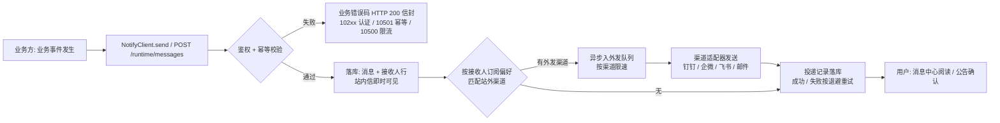

# 产品简介（product-overview）

> notification4j 使用手册 · 01-概览第 1 篇。当前版本 **v1.4.0**。
> 本文回答四个问题：它是什么、解决什么痛点、能做什么、怎么接进来。API 细节以
> [docs/api/api-spec.md](../../api/api-spec.md) 为唯一事实源，产品语义见
> [docs/requirements/prd.md](../../requirements/prd.md)。

## 1. 一句话定位

**notification4j 是通用的应用系统站内消息 / 公告 / 站外通知多租户微中台**：应用系统（租户）通过
**OpenAPI / Java Starter（NotifyClient）** 一个接口发消息，终端用户在**嵌入式消息中心**（iframe 微前端，
五页 + 铃铛）查看通知、自注册 IM 群 webhook 渠道、配置「消息类型 × 渠道」订阅矩阵；独立部署形态内置
外发引擎，将站内消息投递到钉钉 / 企微 / 飞书 / 邮件。

## 2. 解决的痛点：业务方自建通知的成本

各应用系统（权益、钱包、网关、IAM 等）自建通知能力的典型开销（PRD §2.1）：

| 痛点 | 自建现状 | notification4j 的答案 |
|---|---|---|
| 多渠道适配 | 钉钉 / 企微 / 飞书 / 邮件每个系统各接一遍，webhook 散落配置、无统一管理 | 渠道适配器统一封装，用户 / 租户自助注册，平台协议差异收敛在适配器内、业务层无感知 |
| 多租户隔离 | 每系统一套表、一套权限，体验不一致、数据不通 | 租户 OpenID 隔离 + 三域 API + token 双型别，一份部署服务 N 个应用系统 |
| 可靠投递 | 无投递记录、失败无人知晓、无重试口径 | DB 队列 + 指数退避重试 + 失败熔断 + 出站限速 + 死信人工重投，投递全链留痕、成功率可查询 |
| 消息中心前端自研 | 站内信表 / 已读未读逻辑 / 铃铛角标每家重写 | 嵌入式微前端消息中心开箱即用（五页 + 铃铛），接入方 0 前端工作量 |
| 用户订阅偏好 | 用户无法按「应用 A 告警 / 应用 B 账单」差异化接收，无系统支持 | 「消息类型 × 渠道」订阅矩阵 + 强制渠道策略 + 免打扰时段 |
| 接入耗时 | 平均 1~2 周自研且质量参差 | 引 starter + 嵌 iframe，目标 ≤ 0.5 天 |

差异化定位（相对云厂商消息中心，PRD §2.2.8）：**多租户中台**（数据 / 配置 / OEM 全隔离）、
**终端用户级** IM 群 webhook 自注册（云厂商为账号级）、**微前端嵌入**消息中心、与 framework4j /
benefit4j 同构的租户体系可无缝复用。

## 3. 核心能力矩阵

### 3.1 能力清单

> 与 [api-spec 附录 A](../../api/api-spec.md) 的 **54 项契约**（auth 1 / open 1 / runtime 22 / admin 17 /
> platform 13，v1.4.0 已 54/54 全实现）真实分组对齐；每行右列为对应 API 编号。

| 能力 | 说明 | 对应 API 编号 |
|---|---|---|
| 定向消息（站内信） | fanout-on-write：发送即落库 + 接收人行，站内即时可见；1~1000 人同步发送，≤100000 人批量异步 Job（Redis 状态机，TTL 48h） | MSG-001 / MSG-002 / MSG-003（send-results）/ JOB-001 |
| 消息中心用户面 | 我的消息列表（Cursor）、详情（返回即置已读）、批量 / 全部已读、未读数（含公告未确认）、铃铛最近 N 条 | MSG-004 ~ MSG-008 |
| 消息撤回（V1.2） | `SENT→CANCELLED` 状态机；PENDING 外发单语句 CAS 拦截，已 SENDING/SUCCESS 不追回；撤回后用户侧列表 / 详情 / 未读数均不可见 | MSG-009 |
| 公告（广播） | fanout-on-read 免落库展开；平台公告（tenant_id=0）与租户公告合并生效列表；已读 / 确认回执与统计；同租户同时生效 ≤20 条 | ANN-001 ~ ANN-003、AAN-001 ~ AAN-005、PAN-001 ~ PAN-004 |
| 消息类型与模板 | 租户自定义 type_code + 内置类型；`mandatory=1` 强制订阅（平台域 PTE-005 唯一设置入口）；`{{param}}` 模板渲染 + `channel_content` 分渠道覆盖 | TYP-001 / TYP-002、TPL-001 ~ TPL-003、PTE-005 |
| 订阅治理与免打扰 | 「消息类型 × 渠道」订阅矩阵（PUT 全量替换）；INAPP 恒选不可关；强制类型渠道集不可关（10606）；`quiet_hours` 免打扰时段（推迟发送非丢弃，V1.2）；URGENT 无视矩阵全渠道恒投 | SUB-001 / SUB-002 |
| 渠道（自服务） | 用户自注册 IM 群 webhook（钉钉 / 企微 / 飞书，官方域名白名单 + DNS 禁内网段防 SSRF）与 EMAIL 渠道；租户公共渠道（如运维群机器人）；验证按渠道业务码判定、同类型 ≤5、连续失败熔断 | CHN-001 ~ CHN-005、ACH-001 ~ ACH-003 |
| 外发引擎 | DB 队列 + `SKIP LOCKED` 扫描；1/5/15min 指数退避 ≤3 次→DEAD；渠道连续失败 ≥5 次熔断停用；按渠道集中出站限速；DEAD 人工重投；reaper 回收 | DLV-001 / DLV-002、STAT-001 |
| 多租户与安全 | token 双型别（PLATFORM / TENANT 硬隔离：域闸 403 / 型别校验 10300）；租户生命周期（SUSPEND 即时阻断、CLOSE 冷静期）；注册码自助开通租户；**按租户 HMAC 签名开关**（`privileges.signature`）；**嵌入 origin 白名单双面**（构建时 `VITE_NFY_PARENT_ORIGINS` ∪ 运行时 oem.hosts） | AUTH-001、OPEN-001、PRK-001、PTE-001 ~ PTE-004、SEC-001、OEM-001 |
| 平台运营面 | 跨租户概览（含 dead_tenants top20）；平台站内信跨租户只读查询（v1.4.0 新增，`read_count` 已读回执统计） | PST-001、PPM-001 / PPM-002 |
| 字典下发 | 等级 / 渠道类型 / 状态枚举字典，前端禁硬编码 | DICT-001 |
| 开箱即用消息中心前端 | Vue 3 微前端：消息 / 公告 / 渠道 / 订阅 / 投递五页 + 铃铛，iframe 多入口 + postMessage 握手（token 只进内存）；SPA 托管进 jar 免双部署 | 前端载体（配套 OEM-001、DICT-001） |

**渠道支持现状**：`INAPP`（站内信，锁定恒有不可关）、`EMAIL`、IM 群 webhook（`DINGTALK` / `WECOM` /
`FEISHU`）已实现；`SMS` 为规划中渠道（契约演进预留，受离线环境约束尚未落地）。

### 3.2 三域 API 一览

所有接口路径前缀含 `/v1/` 版本段；换 token 端点 `POST /nfy/api/v1/auth/token`（client_credentials）。

| 域 | 路径前缀 | 鉴权 | 典型用途 |
|---|---|---|---|
| 平台域 | `/nfy/platform/api/v1/*` | 平台密钥换 **PLATFORM** 型 token | 租户 CRUD、密钥重置、注册码签发、平台公告、跨租户统计与站内信查询 |
| 租户域 · 管理面 | `/nfy/api/v1/admin/*` | **TENANT** 型 JWT | 类型 / 公告 / 公共渠道 / 模板管理、投递查询与重投、统计 |
| 租户域 · 运行面 | `/nfy/api/v1/runtime/*` | **TENANT** 型 JWT（发送面可叠加 HMAC 签名） | 发消息、用户消息中心、用户渠道、订阅偏好 |
| 开放域 | `/nfy/open/api/v1/*` | 无（IP 限流 + 审计） | 凭注册码自助注册租户（唯一写操作） |

铁律：token 型别硬隔离——TENANT token 打平台域 → HTTP 403（信封 code=403，DomainGuard 域闸）；
token 型别与 `@RequiresToken` 不匹配 → `10300 令牌类型不匹配`（framework4j 实测行为）；
runtime 用户面必须带 `X-User-Id`。（接口文档登记的 `10207 令牌类型不匹配` 为历史占位语义，型别场景实际发射
`10300`；fwk4j 自身 `10207` 仅指令牌格式/解析错误，详见 [error-codes.md](../04-参考/error-codes.md)。）

### 3.3 一条消息的生命周期



关键口径：站内落库即发送成功（响应 `inapp_saved=true`，外发异步）；批量 >1000 人必须走异步 Job
（MSG-002 + JOB-001 轮询）；免打扰时段内的外发投递推迟到窗结束自动发出，不丢弃。

## 4. 三种接入形态

同一套业务实现，按依赖坐标切换形态；业务代码只依赖 `NotifyClient` 门面（嵌入与跨进程同 FQCN），
**切换形态业务代码零改动**（只换依赖坐标与配置）。

| 形态 | 进程边界 | 数据面职责 | 依赖引入 | 适用场景 |
|---|---|---|---|---|
| **独立部署**（fat jar） | 独立进程（默认端口 9200），页面 + OpenAPI 同进程 | 自带：PG + Redis + Flyway 自动迁移 + 外发引擎 + SPA 静态托管 | 无需引依赖，构建产物 `notification4j-app-1.4.0.jar`；异构语言（Python/Go）直接 HTTP 调 OpenAPI | 作为微中台独立运行、多业务方共享；不想往业务进程加通知依赖 |
| **嵌入接入**（`mode=local`） | 与宿主应用同进程，`NotifyClient` 进程内直调（零 HTTP） | 共享宿主 / 接入方自配：MyBatis + PG + Redis（starter 数据面接管为单池，无需 `spring.autoconfigure.exclude`） | `fun.commons.notification4j:notification4j-starter:1.4.0`（JitPack：`com.github.funcommons.notification4j:notification4j-starter:v1.4.0`） | 通知能力嵌进宿主应用进程，最低延迟；宿主已有 PG/Redis |
| **跨进程接入**（`mode=remote`） | 宿主与独立部署实例分进程，HTTP 调用（自动注入 S2S JWT + HMAC 签名） | **零**：零 MyBatis / 零 JDBC / 零 Redis | `fun.commons.notification4j:notification4j-client-starter:1.4.0` | 只发消息 / 公告、调独立部署实例；不想承担数据面依赖 |

> 两个 starter **二选一，不同时引**（全量 starter 含数据面、client-starter 零数据面，同 classpath 属接入
> 错误；意外共存时确定性让位并打 WARN，不做启动 fail-fast）。

三个开关独立控制运行面（嵌入形态默认即安全面，宿主零污染）：

```yaml
nfy:
  data:
    enabled: true        # 数据面闸（配合 @MapperScan 约定）
  runtime:
    mode: local          # local | remote
    enable-api: false    # 是否注册三域 HTTP API
    engine:
      enabled: false     # 外发引擎是否在本进程跑
    client-enabled: true # NotifyClient 门面
```

业务方发消息（嵌入与跨进程同一接口）：

```java
@Autowired NotifyClient notifyClient;
notifyClient.send(tenantId, SendMessageRequest.of(
    "ORDER", List.of("u_1"), "订单已支付", "内容", "NORMAL", null, "biz-1"));   // biz-1 幂等
```

remote 模式最小配置（`remote-url` 缺失 / mode=local 启动即失败；凭据未配则不签名不 NPE，远端会拒）：

```yaml
nfy:
  runtime:
    mode: remote
    remote-url: http://notification4j-svc:9200
    remote-tenant-id: <业务方租户 OpenID>
    remote-tenant-secret: <HMAC 签名密钥>
```

形态选择速查：最低延迟 / 最高吞吐 → 嵌入 local；只发消息、不引数据面依赖 → 跨进程 remote；
多业务方共享、异构语言客户端、升级中台不影响业务方 → 独立部署。

## 5. 术语表

| 术语 | 定义 |
|---|---|
| 租户（Tenant） | 接入的应用系统，数据 / 配置 / OEM 的隔离边界；由平台域创建（PTE-001）或凭注册码自助注册（OPEN-001） |
| 租户 OpenID（open_id） | 租户对外唯一暴露的标识（换 token 的 `client_id`）；内部雪花 id 不出网，平台域路径参数一律用它 |
| 用户（user_id / X-User-Id） | 终端用户标识，字符串 ≤64，runtime 用户面以请求头 `X-User-Id` 透传——**不建档、不鉴权**，权限边界永远且仅是 tenant_id |
| 消息（Message） | **定向**站内消息（发给指定用户 / 批量用户），fanout-on-write：发送即落接收人行 |
| 公告（Announcement） | **广播**消息（平台→全部租户 / 租户→全部用户），fanout-on-read：不预写接收人，按已读回执表计算；平台公告 tenant_id=0 |
| 消息类型（type_code） | 租户自定义（如 `ORDER`/`SECURITY`）+ 内置 `SYSTEM`/`ANNOUNCEMENT`；订阅、模板、统计均按类型；`mandatory=1` 时其 `default_channels` 为强制渠道集 |
| 消息等级（level） | `NORMAL` / `IMPORTANT` / `URGENT`；URGENT = INAPP 恒投 + 该用户全部 ENABLED 注册渠道（无视订阅矩阵、忽略免打扰） |
| 渠道（Channel） | `INAPP`（站内信，锁定恒有）+ `DINGTALK`/`WECOM`/`FEISHU`（IM 群 webhook）+ `EMAIL`；分**用户渠道**（用户自注册）与**租户公共渠道**（管理面注册） |
| 订阅矩阵（Subscription） | 用户 × 消息类型 × 渠道集合（`items[].channel_ids` 为渠道实例 ID + `"INAPP"` 哨兵）；PUT 全量替换语义；渠道删除 / 熔断自动剔除，行空自动回落 INAPP |
| 投递（Delivery） | 消息 / 公告 × 渠道的外发记录，状态机 PENDING→SENDING→SUCCESS/FAILED→DEAD（+CANCELLED）；全链路可观测的根基 |
| 回执 | 用户侧已读 / 确认记录：消息详情即置已读（MSG-005）、公告阅读 / 确认（ANN-002/003）、统计（AAN-005、PPM-002 `read_count`） |
| biz_no | 业务方业务号（幂等键），服务端 `UNIQUE(tenant_id, biz_no)` 真闸；撤回不触碰幂等记录，同号重发仍 10401 |
| Idempotency-Key | 创建类写操作必填的请求头（UUID v4，服务端保留 48h）；同 key 同 body 回放首次结果，同 key 不同 body → `10501` |
| quiet_hours | 订阅行级免打扰时段 `{start,end}`（HH:mm，可跨午夜）；语义 = **推迟发送非丢弃**：外发投递 `next_retry_at` 置窗结束时刻，窗到由引擎自动发出 |
| 模板（Template） | 标题 / 内容模板 + `{{param}}` 占位符（参数名限 `\w`），按类型绑定；`channel_content` 可分渠道覆盖渲染 |
| 注册码（Registration Key） | 平台签发的一次性开通凭据（次数 / 有效期 / 预绑配置档），开放域凭码自助注册租户，原子扣减 |
| oem.hosts | 租户 OEM 配置中的嵌入父页 origin 白名单（frame-ancestors / postMessage 双用途）；平台域 PTE-002 写入，API-OEM-001 运行时下发 |
| fanout 双模型 | 定向消息 fanout-on-write（发送即写接收人行）；公告 fanout-on-read（中台不掌握用户全集，广播只能按需计算） |

## 6. 技术栈与运行要求

| 项 | 值 |
|---|---|
| 运行要求 | JDK 17+ · PostgreSQL 16 · Redis 7 |
| 技术底座 | framework4j v1.7.1（web / accesstoken / signature / rate-limit / idempotency / cache / datasource / redis 等） |
| 框架钉版 | Spring Boot 3.2.7 · MyBatis-Plus 3.5.7 |
| 前端 | Vue 3 微前端（五页 + 铃铛），SPA 产物托管进 jar，免双部署 |
| 独立部署产物 | `notification4j-app-1.4.0.jar`（fat jar，默认端口 9200，Flyway 首启自动迁移 12 张表） |

## 7. 进一步阅读

| 主题 | 文档 |
|---|---|
| 架构深读（选读） | [technical-whitepaper.md](technical-whitepaper.md) · [SAD 系统架构设计](../../design/system-design.md) · [数据库设计](../../design/database-design.md) |
| 快速开始 | [5 分钟总览](../02-快速开始/quickstart-5min.md) · [嵌入形态](../02-快速开始/quickstart-embed.md) · [跨进程形态](../02-快速开始/quickstart-remote.md) · [前端嵌入](../02-快速开始/quickstart-frontend.md) |
| API 契约 | [api-spec.md](../../api/api-spec.md)（唯一事实源：三域 54 项契约 + 错误码 + 信封 + 限流 + 分页） |
| 关键决策（ADR） | [fanout 双模型](../../design/adr/adr-0002-dual-model-fanout.md) · [外发引擎 DB 队列](../../design/adr/adr-0003-db-queue-engine.md) · [token 双型别](../../design/adr/adr-0007-token-dual-type.md) · [按租户签名](../../design/adr/adr-0008-per-tenant-signature.md) · [撤回竞态语义](../../design/adr/adr-0010-cancel-race-safe-semantics.md) |
| 产品需求 | [prd.md](../../requirements/prd.md) · 项目主页 [README](../../../README.md) |
