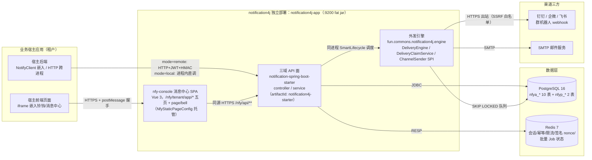
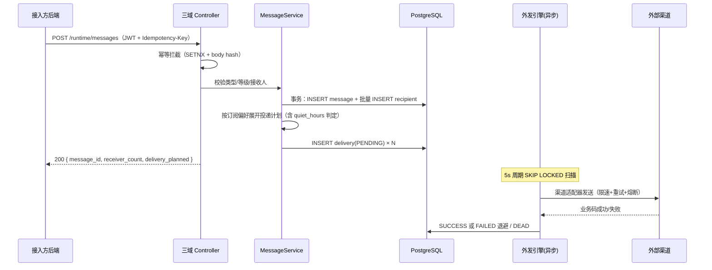

# notification4j 技术白皮书

> **面向读者**：技术决策者 / 架构师 / 接入方技术负责人
> **版本口径**：v1.4.0（2026-09-21）｜ framework4j v1.7.1 ｜ Spring Boot 3.2.7 / JDK 17 / MyBatis-Plus 3.5.7 / PostgreSQL 16 / Redis 7
> **事实来源**：本文全部类名、配置键、默认值、阈值均取自仓内源码与文档（`backend/pom.xml`、引擎源码、`backend/notification4j-app/src/main/resources/application.yml`、[SAD](../../design/system-design.md)、[ADR](../../design/adr/)、[api-spec](../../api/api-spec.md)、[CHANGELOG](../../../CHANGELOG.md)）；证据版本以 v1.4.0 tag 为准。

---

## 1. 执行摘要

notification4j 是多租户消息通知微中台：应用系统（租户）一次 API 调用完成「站内消息 + 公告 + 站外渠道外发」，终端用户经嵌入式微前端消息中心查看与自助管理。核心价值主张：

| # | 价值主张 | 依据 |
|---|---|---|
| 1 | **接入成本低**：同一份代码经 yml 开关支持三形态——独立部署（fat jar）、业务方同进程嵌入（starter，local 直调）、跨进程调用（client-starter，零 MyBatis/JDBC/Redis）；嵌入方一个 `NotifyClient` 门面 + 一段 iframe 标签即完成接入 | [SAD §5.1](../../design/system-design.md)、[backend/README](../../../backend/README.md) |
| 2 | **消息双模型**：定向消息 fanout-on-write（精确已读状态）+ 公告 fanout-on-read（回执表计算，中台无需掌握用户全集），一套模型同时覆盖精确触达与广播 | [ADR-0002](../../design/adr/adr-0002-dual-model-fanout.md) |
| 3 | **站外外发可观测可自治**：DB 队列 + `SKIP LOCKED` 扫描的内置引擎，退避重试、死信、渠道熔断（连续失败 ≥5 自动 DISABLED + 属主站内信）、每渠道限速，全链投递留痕、支持人工重投 | [ADR-0003](../../design/adr/adr-0003-db-queue-engine.md)、[ADR-0004](../../design/adr/adr-0004-channel-spi-centralized-ratelimit.md)、§4.2 |
| 4 | **租户隔离与安全默认**：token 双型别硬隔离（PLATFORM/TENANT）、雪花 id 经 OpenID 混淆不出网、渠道凭据 AES-256-GCM、webhook SSRF 四层纵深、审计 hash chain | [ADR-0007](../../design/adr/adr-0007-token-dual-type.md)、§4.4 |
| 5 | **工程门槛可验证**：四层测试体系（单测 421 + IT 136 + vitest 386 + E2E 72）全绿、JaCoCo 双覆盖率门槛绑定构建防回退、接口契约 54 项全实现 | [test-plan](../../test/test-plan.md)、[api-spec 附录 A](../../api/api-spec.md)、§6 |

## 2. 典型场景

以下场景自 [PRD](../../requirements/prd.md) 用户故事与角色（§2.1 痛点、§2.4 角色）提炼，括号内为支撑功能项：

| 场景 | 角色 | 链路 |
|---|---|---|
| **业务事件定向通知**：订单支付成功 / 安全告警，发给指定用户；站内即时可见，同时按该用户订阅偏好外发钉钉/企微/飞书/邮件 | 接入系统 `ROLE_INTEGRATOR` | `NotifyClient.send` → 落库 + 订阅矩阵展开投递计划 → 引擎异步外发（F-MSG-001 / F-SUB-001） |
| **运维群告警广播**：租户公告勾选公共渠道（如运维群机器人），发布即外发；订阅 ANNOUNCEMENT 类型的用户个人渠道同步生效 | 租户管理员 `ROLE_TENANT_ADMIN` | 公告发布 → `DeliveryPlanService.planForAnnouncement` 双生效路径（F-ANN-001） |
| **平台公告触达全部租户**：平台运营面向所有租户的公告（`tenant_id=0` 合成平台租户），各租户用户在消息中心看到并确认 | 平台运营 `ROLE_PLATFORM` | 平台域发布 → runtime 查询以 `tenant_id IN (0, :tid)` 合并生效（F-ANN-002） |
| **用户自助渠道与免打扰**：终端用户自注册钉钉/邮箱渠道、按消息类型配置接收渠道与静默时段；静默窗内外发推迟到窗结束自动补发 | 终端用户 `ROLE_END_USER` | F-CHN-001 渠道注册验证 + F-SUB-001 订阅矩阵（`quiet_hours` 经 API-SUB-002 契约承载，ADR-0011） |
| **宿主应用嵌入铃铛**：任意技术栈宿主页面以 iframe 嵌入消息铃铛，postMessage 握手传递短期 token，30s 轮询未读角标 | 终端用户 / 宿主前端 | F-MSG-002 + F-EMB-001（§4.5） |
| **平台跨租户消息审计**：平台管理员按用户/类型/时间跨租户检索全部租户站内信历史（v1.4 新增，诉求方 MMagiX2） | 平台运营 | API-PPM-001/002 平台站内信只读查询面 |

PRD §2.1 登记的痛点即上述场景的反面：各系统各写一套站内信/铃铛、webhook 散落配置无投递记录、无按类型订阅偏好、新系统自研 1~2 周——中台化后统一收口。

## 3. 总体架构

### 3.1 容器图（C4-L2，组件命名对齐 [SAD §4.2](../../design/system-design.md)，括注真实模块/包名）



要点：

- **外发引擎内嵌于 app 进程**（`DeliveryEngine implements SmartLifecycle`，独立调度线程池），P6 无状态原则下多实例以 PG `SKIP LOCKED` 竞争消费，天然互斥；流量上来可拆独立 worker，代码零改动（ADR-0003）。
- **同一 starter 既是独立部署的业务实现，也是嵌入方的依赖**（见 §3.3 装配矩阵）；`remote × engine.enabled=true` 为非法组合，启动 fail-fast。
- 前端 SPA 构建产物入 jar（classpath `/nfy-console/`），单进程同时服务页面与 API，免双部署。

### 3.2 技术栈与依赖边界

| 层 | 选型 | 说明 |
|---|---|---|
| 运行时 | Spring Boot 3.2.7 / JDK 17 | `backend/pom.xml` 钉版 |
| ORM | MyBatis-Plus 3.5.7 + Druid（出厂 `filters: stat,slf4j`） | wall 不兼容 PG `SKIP LOCKED`/部分索引，出厂显式关 |
| 底座 | framework4j v1.7.1（16 模块） | 认证/签名/限流/幂等/审计/加密/分布式 ID 等零自建，映射见 §3.4 |
| 存储 | PostgreSQL 16（Flyway 全量迁移，12 表）+ Redis 7 | 部分索引承接未读/待投递热路径 |
| 前端 | Vue 3 SPA（五页 + 铃铛单页） | vitest / vue-tsc / eslint 全绿 |
| 自建件 | 外发引擎、ChannelSender SPI、未读数缓存策略 | framework4j 无对应模块，留 ADR-0003/0004/0005 |

### 3.3 Maven 模块拓扑与三形态装配

```
backend/（parent: notification4j-parent, 1.4.0）
├── notification-spring-boot-starter   ← artifactId notification4j-starter：全量业务实现
│                                         （三域 API / service / engine 包 / NotifyClient / SPA 托管）
├── notification4j-client-starter      ← 跨进程轻量接入（remote-only，零数据面）
├── notification4j-app                 ← 独立部署壳（fat jar + Flyway + OpenAPI）
└── notification4j-it                  ← 集成测试（Testcontainers PG16+Redis7）
```

**装配条件矩阵**（`NfyProperties` 前缀 `nfy.runtime`，缺省值自源码核实）：

| Bean / 能力 | 条件与缺省 |
|---|---|
| `LocalNotifyClient`（进程内直调） | `mode=local`（缺省） |
| `RemoteNotifyClient`（HTTP + JWT + Idempotency-Key） | `mode=remote` + `remote-url` 必填（缺失启动失败） |
| `NotifyClient` 门面 | `client-enabled=true` 开启（缺省 false） |
| 三域 Controller | `enable-api` —— **缺省分侧**：starter 侧 false（嵌入方进程不意外暴露 HTTP 面），app 出厂 true |
| 外发引擎 | `engine.enabled` —— 缺省 false（嵌入形态默认不跑），app 出厂 true |
| SPA 静态托管 | `nfy.static-page.enabled` —— 缺省 false（嵌入方零污染），app 出厂 true |

三形态与接入方式（细节见 [backend/README](../../../backend/README.md)）：

| 形态 | 依赖 | 数据面 | 典型用法 |
|---|---|---|---|
| 独立部署 | `notification4j-app` fat jar | 自带（PG/Redis/引擎/SPA 全开，:9200） | 中台中心化部署，多租户共用 |
| 业务方嵌入 | `notification4j-starter`（local） | 共享中台库或自库；`NfyDataPlaneTakeoverFilter` 接管原生装配（v1.3，接入方零 `spring.autoconfigure.exclude`）；`NfyMybatisPlusSupportAutoConfiguration` 雪花 id 兜底 | 宿主进程内直调，零网络跳 |
| 跨进程 | `notification4j-client-starter`（remote） | **零 MyBatis/零 JDBC/零 Redis**；`NfyHmacSigner` 内置签名（与 fwk4j 线协议逐字节一致）；连接/读超时缺省 5s/10s | 宿主只发消息，指向独立部署实例 |

两 starter 的 `NotifyClient` / `SendMessageRequest` / `AnnounceRequest` / `NfyClientException` 四件同 FQCN——嵌入与跨进程切换**只换依赖坐标，业务代码零改动**。

### 3.4 framework4j 能力映射（零自建清单）

| 需求 | framework4j 模块 | 本项目用途 |
|---|---|---|
| 认证/JWT/踢人 | fwk4j-accesstoken | 双型别 token、会话管理、reset 撤会话 |
| 信封/错误码 | fwk4j-api + fwk4j-web | ApiResponse 信封、ApiCode、全局异常 |
| 签名防重放 | fwk4j-signature | runtime 发送面 HMAC（按租户开关） |
| 接口限流 | fwk4j-rate-limit | API 面限流（出厂 100 次/min/客户端 IP/路径，滑动窗口） |
| 缓存 | fwk4j-cache | 订阅矩阵、类型/渠道配置二级缓存 |
| 幂等 | fwk4j-idempotency | 写接口 Idempotency-Key 48h |
| 审计 | fwk4j-audit | 平台域 + admin 面写操作 hash chain（`nfyp_audit_log`） |
| 脱敏/加密 | fwk4j-sensitive | tenant_secret / channel.secret AES-256-GCM；webhook/邮箱脱敏 |
| 分布式 ID | fwk4j-id | 全表雪花主键；租户 OpenID 混淆外显 |
| 时间/SQL 追踪 | fwk4j-datetime / fwk4j-sql-tracing | OffsetDateTime 序列化；SQL 注 trace_id |
| 多数据源/Redis | fwk4j-datasource / fwk4j-redis | 单库单 Redis（多源能力预留） |

## 4. 关键机制设计

### 4.1 消息双模型：定向 fanout-on-write + 公告 fanout-on-read（ADR-0002）

中台不掌握租户用户全集（`X-User-Id` 透传不建档），两类消息走不同扇出模型：

| 模型 | 定向消息（`nfya_message`） | 公告（`nfya_announcement`） |
|---|---|---|
| 扇出时机 | **写时**：发送事务内批量 INSERT `nfya_message_recipient` 接收人行 | **读时**：不预写接收人，按 `nfya_announcement_read` 回执表计算已读/未确认 |
| 已读语义 | recipient 行 `read_status` 精确到人 | 回执表 LEFT JOIN（uk 索引覆盖） |
| 外发计划 | `DeliveryPlanService.planForMessage`：按接收人订阅矩阵展开（URGENT 走全部 ENABLED 渠道、绕过订阅矩阵） | `planForAnnouncement` **双生效**：①公告勾选的租户公共渠道（scope=TENANT）；②订阅 ANNOUNCEMENT 类型用户的个人渠道 |
| 幂等闸 | `UNIQUE(tenant_id, biz_no)` 真闸 + Idempotency-Key 拦截 | 投递行 `UNIQUE(source...)` 防重 |

平台公告即 `tenant_id=0` 的公告行；runtime 生效查询以 `tenant_id IN (0, :tid)` 豁免收口过滤，该豁免写进查询收口层规约并有越权用例覆盖（PRD §2.5）。

发送主链路（同步段只落库+写计划即返回，外发全部异步——渠道故障不影响主链路，SAD P4 原则）：



发送方可经 `GET /runtime/send-results/{biz_no}` 立即看到计划数与后续状态，链路全留痕。

### 4.2 外发引擎：DB 队列 + SKIP LOCKED（ADR-0003/0004）

引擎位于 `backend/notification-spring-boot-starter/src/main/java/fun/commons/notification4j/engine/`，由 `DeliveryEngine`（调度/回写）、`DeliveryClaimService`（领取短事务）、`ChannelSender` SPI（`ImWebhookSender` / `EmailSender` 内置实现）组成。

**领取**（`NfyaDeliveryMapper.claimBatch` 原生 SQL）：

```sql
SELECT d.* FROM nfya_delivery d
JOIN nfya_channel c ON c.id = d.channel_id AND c.status = 'ENABLED' AND c.is_deleted = 0
WHERE d.is_deleted = 0 AND d.status IN ('PENDING', 'FAILED') AND d.next_retry_at <= #{now}
ORDER BY d.next_retry_at
LIMIT #{batch}
FOR UPDATE OF d SKIP LOCKED
```

- JOIN 渠道须 ENABLED：停用/熔断渠道的投递行原地等待恢复，不计重试；
- `DeliveryClaimService.claim` 为独立 `@Transactional` 短事务：锁行 → 单语句批量置 SENDING → 提交，外呼不持锁。

**状态机与回写**（全部 CAS：仅 `status='SENDING'` 可迁移，0 行更新即放弃，防 reaper 回收后陈旧 worker 覆盖新状态）：

| 迁移 | 触发 | 参数（出厂默认，`NfyProperties.Engine` + app `application.yml` 双证） |
|---|---|---|
| PENDING/FAILED → SENDING | 扫描领取 | `scan-interval-ms=5000`、`batch-size=50` |
| SENDING → SUCCESS | 渠道业务码成功（钉钉/企微 errcode=0、飞书 code=0、SMTP 2xx） | 同时回写渠道 `fail_count=0` + `last_verify_at`（EMAIL 渠道可用性证据，ND-L5-01） |
| SENDING → FAILED | 投递失败 | `retry_count+1`；退避档 `backoff-seconds="60,300,900"`（1/5/15min，按重试次数取档）；渠道 `fail_count` 原子 +1 |
| FAILED → DEAD | `retry_count > 3`（`MAX_RETRY=3`） | 死信可经 admin 面 API-DLV-002 人工重投 |
| SENDING → DISABLED 熔断 | 渠道 `fail_count ≥ 5`（`BREAKER_THRESHOLD=5`）单语句 CAS | 渠道置 DISABLED + 属主站内信（type=CHANNEL_ALERT、level=URGENT、biz_no 带熔断纪元防二次熔断撞 uk） |
| SENDING → PENDING（reaper） | SENDING 超时回收 | `reaper-interval-ms=60000`、`sending-stale-ms=600000`（10min）；回收行 `next_retry_at=now` 立即可重扫 |

注意两个计数器分离：投递行 `retry_count`（单任务重试，驱动退避/DEAD）与渠道 `fail_count`（连续失败熔断计数，成功清零）。

**每渠道限速**（at-least-once）：`DeliveryEngine.tryAcquireChannelQuota` 按渠道实例的进程内固定窗（窗=1 分钟，`rate-limit-per-minute=18` 默认，即钉钉/企微 20 条/min/机器人硬限额的 90%；`0`=关闭）。超限投递归还 PENDING 延后再投，**不计失败重试**——限速不产生死信。已登记边界：V1.0 为单机内存窗，多实例部署合计可能超机器人限额（SAD §5.5 已登记），切 fwk4j-rate-limit Redis 集中式为演进项。

**线程模型**：投递 Worker 为跨渠道共享固定池 `worker-count=4`（守护线程 `nfy-engine-worker-*`）；按渠道类型独立线程池登记为排期项。

**渠道适配器 SPI**（新增渠道 = 新增一个 `ChannelSender` 实现，核心引擎零修改）：

```java
public interface ChannelSender {
    String channelType();                                    // DINGTALK/WECOM/FEISHU/EMAIL
    default boolean supports(String channelType) { ... }     // 默认按 channelType 精确匹配
    SendResult send(NfyaDelivery delivery, NfyaChannel channel);  // 纯外呼，状态由引擎统一回写
    record SendResult(boolean ok, String summary) { ... }    // ok = 渠道业务码成功
}
```

sender 链内建在前、业务方自定义 `ChannelSender` Bean 在后，解析反向匹配——**自定义实现可覆盖内建**。三 IM 协议差异在适配器内部消化（业务层无感知）：

| 差异点 | 钉钉 | 企微 | 飞书 |
|---|---|---|---|
| 消息类型字段 | `msgtype` | `msgtype` | `msg_type`（嵌套 content） |
| 加签 | HMAC-SHA256 拼 URL | 不支持（关键词/IP） | 签名放 body |
| 平台限额 | 20 条/min/机器人 | 20 条/min/机器人 | 可配（默认 50/min） |

邮件渠道：SMTP 账号经 `nfy.runtime.engine.mail-host/port/from/username/password` 配置（缺省 host 为空——EMAIL 渠道投递直接失败走重试→DEAD），SMTP 2xx 判定成功。渠道重启用语义（ND-L5-01 后）：IM 须先验证（`last_verify_at` 非空）+ 未熔断；EMAIL 豁免已验证前置——PENDING 可直启（首次投递时校验兜底），熔断态显式重启用即视为重新验证（ENABLED 同时 `fail_count` 归 0）。

> **防评审误读——出厂默认 vs E2E 提速参数**：`frontend/e2e-regression/bin/start-app.sh` 为测试实例注入 `scan-interval-ms=500`、`backoff-seconds=2,5,10`、`reaper-interval-ms=1000`、`sending-stale-ms=5000`、`rate-limit-per-minute=600`、SMTP 指向 localhost:3925 收包器——这些**仅为 E2E 提速旋钮**，出厂默认以上表为准（`NfyProperties` 缺省值 = app `application.yml` 出厂段）。

### 4.3 未读数：写时失效 + 公告水位线（ADR-0005）

**设计**（ADR-0005 / SAD §5.6 / api-spec §5.3 性能预算 P99 ≤ 200ms）：

- 未读数 = 定向消息未读数 + 生效中需确认公告的未确认数（controller 合成 `unread_count`/`unconfirmed_count`/`total` 三字段）；
- 定向维度**写时失效**（cache-aside）：发送扇出/已读/确认时 DEL `nfy:unread:{tenant_id}:{userid}`，miss 查库回填；仅 Redis L2、关闭 Caffeine L1（防多实例陈旧窗口），TTL 1h 兜底；
- 公告维度不可按用户枚举失效（中台无用户全集），缓存值携带**公告水位线** = `max(updated_at) over tenant_id IN (0,:tid)`（含平台公告；发布/下线/定时置 EXPIRED 均变更 updated_at），读取时重算比对、不一致即重算；时间驱动变化由 TTL 兜底；
- 弃用增量计数（DB 提交后 N 个 INCR 非原子，漂移不可修复）。

**实装现状（v1.4.0，源码核实）**：Redis 缓存与水位线**延后未实装**——当前 `MessageService.unreadInappCount` 直查 DB 部分索引、`AnnouncementService.unconfirmedCount` 一次 SQL（LIMIT 100 防御性兜底）；该偏差由 api-spec 修订史 V1.0.6 第②项登记（「§5.3 Redis 缓存/水位线延后，查询带 LIMIT 100 兜底」）。性能预算 200ms 依靠部分索引 `idx_nfya_recipient_unread`（`(tenant_id, userid) WHERE read_status='UNREAD' AND is_deleted=0`）与回执表 uk 索引支撑。前端铃铛 30s 轮询（页面不可见暂停），URGENT 到达经 postMessage 通知父页（`BellPage.vue`）；SSE/WebSocket 推流为 V2.0 演进（ADR-0005 备选 C）。

### 4.4 多租户与安全

| 机制 | 实现与出厂值 |
|---|---|
| **token 双型别**（ADR-0007） | `POST /nfy/api/v1/auth/token`（client_credentials）签发，claims 含 `type/tenant_id/iss/jti`；TENANT 与 PLATFORM 型别拦截器互打 `10207`（HTTP 200 + 信封，裸 401 仅网关层）。app 出厂 `framework4j.tenant.auth.token-type: TENANT`、`expire-seconds: 28800`（8h，上限 12h）；TENANT policy 自动续期 `renew-increment: 1800` |
| **平台身份** | 平台密钥走环境变量（`PLATFORM_CLIENT_ID/SECRET`），换取 `tenant_id=0` 合成 token；平台域闸 `@PlatformDomain` + `@RequiresToken(TENANT)` |
| **用户标识** | `X-User-Id` 请求头透传字符串（落库 `userid varchar(68)`），必填（缺失 10101）、不鉴权、不进 JWT；权限边界永远且仅是 `tenant_id`（PRD §2.4） |
| **按租户 HMAC 签名**（ADR-0008） | runtime 发送面 HMAC-SHA256 防重放（`X-Access-Key/X-Timestamp/X-Nonce/X-Signature` 四元组，`timestamp-tolerance-ms: 300000` ±5min、`nonce-ttl-seconds: 600`）；按租户开关 `privileges.signature`：未开启不校验、开启后未注册=全拒、已注册=强制校验（四态错误码 10302）。**出厂默认（V1.2.2/D-1）`framework4j.signature.path-patterns: []`**——SPA 与 S2S 共用 runtime 路径、嵌入面无 secret 可签，出厂不强制；基础设施保留（`NfyTenantSecretProvider` 密钥解析 + `NfySignatureFaceTest` 防回归），S2S 需要时自行加回 pattern |
| **ID 混淆不出网** | 全表雪花主键（`IdType.ASSIGN_ID` + framework4j-id）；平台域租户资源路径一律 `tenant_open_id`（`IdObfuscator.toOpenId` 12 字符混淆），内部雪花 id 不出网（api-spec 附录 A 注；租户创建响应即 `{open_id, tenant_secret}`，明文密钥仅此一次） |
| **凭据与脱敏** | `tenant_secret`/渠道 secret AES-256-GCM（`framework4j.sensitive`，密钥环境变量 `AES_KEY`）；webhook/邮箱展示脱敏；密钥轮换 prev 双版本宽限 `grace-hours: 24`，reset 撤销存量会话 |
| **接口面防护** | 限流 100 次/min 滑动窗口（出厂 `default-scope: APP` 未命中 fwk4j 小写 scope 分支，实际按客户端 IP/路径维度），覆盖 `runtime/**`、`assets/**`、`open/**`（open 域无鉴权、IP 限流兜底）；幂等 `Idempotency-Key` TTL 172800（48h）+ body hash（同 key 不同 body 拒绝），覆盖 messages/channels/subscriptions 写面；防爆破 `max-fail: 5` 锁 15min；审计写操作 hash chain 落 `nfyp_audit_log` |
| **webhook SSRF** | https + 域名白名单 + DNS 解析禁内网 + 出站防火墙白名单（纵深四层，SAD §7.3#14） |
| **内容 XSS** | markdown 白名单渲染（禁 HTML 注入），链接仅 http/https |

租户生命周期由平台域收口：ACTIVE ⇄ SUSPENDED → CLOSED（终态，API-PTE-004）；SUSPEND 后换 token 即拒。租户接入双通道：平台创建（密钥一次性返回）与注册码自助注册（`nfyp_registration_key` 一次性显示/次数/有效期/预绑配置档，开放域 DB 单语句原子扣减，`consumed_tenant_id` 回填）。

### 4.5 嵌入与握手（ADR-0006）

**iframe + postMessage**（不做 npm 组件包/Web Component——强耦合宿主技术栈与发版节奏）。路由（`frontend/src/router/index.ts`）：app 壳 `/nfy/tenant/app/{messages,announcements,channels,subscriptions,deliveries}` 五页 + 单页壳 `/nfy/tenant/page/bell`。

握手协议（`useEmbedHandshake.ts` 源码口径）：

```text
iframe → 父页   { type: 'NFY_READY' }      每 500ms 重发直至收到 token（防父页监听未就绪死锁）
父页  → iframe  { type: 'NFY_TOKEN', token, user_id }
```

- **token 不进 URL/不进 storage**：token/user_id 只持内存（暴露面 7→1）；token 过期（401 → `notifyExpired`）回到 waiting 重新握手；
- **origin 白名单双面**（V1.3，issue #1）：构建时 `VITE_NFY_PARENT_ORIGINS` ∪ 运行时 `oem.hosts`——构建时名单外的父页 origin，iframe 持候选 token 调 `GET /nfy/api/v1/runtime/oem/hosts`（API-OEM-001）核验，命中才接受 NFY_TOKEN；未命中/拉取失败一律忽略（fail-closed，防恶意父页注入）；同 token 在途请求去重；
- **OEM 白标**：`?brand=&mode=&language=`（白名单校验防注入），优先级 query > postMessage > oem（host 匹配）> 内置默认；`frame-ancestors` 按租户 `oem.hosts` 下发。

**宿主域同源反代 `/nfy/` 双轨**（commit `697fdf7`，v1.4.0 后）：宿主经自身域名反向代理嵌入时，前端 vite `base='/nfy/'` 使产物资产引用带 `/nfy` 前缀（宿主 `/nfy` 段原样透传不 rewrite）；服务端 `NfyStaticPageConfig` 双轨承接——`/nfy/assets|images|oem/**` 资源映射与 `/nfy/favicon.svg`、`/nfy/logo.svg` 转发，与根前缀映射并存，独立部署（:9200 根路径）旧引用不受影响。`logoUrl` 以 `import.meta.env.BASE_URL` 前缀拼接，避免 base 下解析到宿主源根路径 404。

## 5. 可靠性语义

| 语义 | 口径 | 依据 |
|---|---|---|
| **外发 at-least-once** | reaper 回收或进程崩溃重投可能导致渠道侧重复，契约明示可接受；换取「任务持久在库、重启不丢、实例宕机由存活实例接续」 | ADR-0003、`DeliveryEngine` 类注释 |
| **biz_no 幂等** | `UNIQUE(tenant_id, biz_no)` 数据库真闸（同租户同业务号重发 10401），Idempotency-Key 48h 为 API 面拦截层；撤回**不解除**幂等记录，同 biz_no 重发仍拒 | api-spec、ADR-0010 |
| **撤回竞态安全，不追回已投递** | `POST /runtime/messages/{message_id}/cancel`：级联拦截仅条件 UPDATE `status='PENDING'` 的投递置 CANCELLED（已 SENDING/SUCCESS/FAILED/DEAD 不动）；消息主行条件 UPDATE（eq SENT，已撤幂等成功）；双条件 UPDATE 与引擎 CAS 天然互斥，无中间态；不存在/跨租户/非数字 id 统一 10400 防探测；用户侧列表/详情/未读数对 CANCELLED 不可见 | [ADR-0010](../../design/adr/adr-0010-cancel-race-safe-semantics.md)，IT `NfyMessageCancelTest` 5 用例 |
| **免打扰推迟非丢弃** | 订阅 `quiet_hours`（jsonb）命中静默窗 → 投递行 `next_retry_at` 直接置窗结束时刻（跨午夜两段判定），引擎按 `next_retry_at<=now` 自动补发，`DeliveryEngine` 零改动；URGENT（全量渠道路径不经订阅矩阵）与 INAPP（落库即达）天然豁免；脏数据 fail-open 即时投递并告警（宁打扰不丢消息） | [ADR-0011](../../design/adr/adr-0011-quiet-hours-plan-defer.md)、`DeliveryPlanService.quietWindowEnd` |
| **降级路径** | 渠道故障只影响该渠道（熔断+重试）；Redis 故障时未读数直查 DB（部分索引兜底）；外发积压超阈值降级新外发登记为延迟批次（10502） | SAD §7.1 |

质量目标（设计口径，SAD §2.4）：SLA 99.9%（消息非交易链路）、RTO ≤ 30min、RPO ≤ 5min；发送 API P99 ≤ 500ms、未读数 P99 ≤ 200ms、消息列表 P99 ≤ 500ms、引擎扫描周期 ≤ 5s。

## 6. 质量与工程

### 6.1 四层测试体系（v1.4.0 实跑口径，[test-plan](../../test/test-plan.md) / [backend/README](../../../backend/README.md)）

| 层 | 内容 | 规模 | 命令（`backend/` 下） |
|---|---|---|---|
| L-A 单元 | starter 纯单测（Mockito/独立上下文，无容器）；另有 client-starter 纯单元 10 | **421** | `mvn -o test -pl notification-spring-boot-starter` |
| L-B 冒烟 | 一条顺序链 8 步跑通核心业务闭环（全仓唯一 `@Tag("smoke")`，冷启动 ≤90s） | 8 | `mvn -o test -pl notification4j-it -Dgroups=smoke` |
| L-C 集成回归 | Testcontainers PG16+Redis7 真库 Flyway 迁移，30 套件按八业务线分组 | **136** | `mvn -o test -pl notification4j-it` |
| L-D E2E | Playwright 八业务线 8 spec，对**出厂等价 fat jar** 全链路验证（出厂偏差为零环境覆盖） | **72** | `npx playwright test -c e2e-regression/playwright.config.ts` |
| 前端 | vitest（含握手运行时白名单等用例） | **386** | `frontend/` 下 vitest |

冒烟链与常规 IT 的刻意差异：常规 IT 用例相互独立、禁顺序依赖；冒烟链本质是一条业务事务（换 token → 建类型发消息 → 读 → 订阅 → 公告 → 撤回 → 投递运维 → 健康），定位是快速健康证明，覆盖由 L-A + L-C 负责。

### 6.2 覆盖率双门槛（绑定 starter build 的 `jacoco:check`，防回退）

- **口径**：starter 单测 exec + IT exec（`notification4j-it/target/jacoco-it.exec`）**合并**（MockMvc 全链路覆盖的 controller/autoconfigure/engine 调度线程计入），check 基于 `jacoco-merged` 报告；
- **门槛一**：`dto / entity / kms / tracelog / client / util / controller` 七包行覆盖 **100%**（`RemoteNotifyClient`、`WebhookSigner` 两个纯防御 catch 类按类精确排除，仍受门槛二兜底）；
- **门槛二**：BUNDLE 行覆盖 ≥ **96%**（合并口径实测：v1.3.0 轮 96.66%、v1.4.0 轮 96.14%，随版本浮动、门槛恒定）；
- **新鲜度**：合并取最近一次 IT 运行的 exec；改 starter 后未重跑 IT 则 check 刻意拦红提示重跑。

### 6.3 契约与发布口径

- 接口契约 **54 项全实现**（api-spec 附录 A 矩阵）：auth 1 / open 1 / runtime 22 / admin 17 / platform 13；演进节奏为 V1.0 交付 50 项 + #51 撤回（v1.2）+ #52 oem.hosts（v1.3）+ #53/#54 平台站内信查询（v1.4），每一项均有 Testcontainers 集成测试；
- git tag / GitHub Release 的 `vX.Y.Z` 对齐 api-spec 修订史；**Maven 坐标与 tag 自 v1.3.0 起一致**（v1.0.0 时期存在注册在案的版本错位，v1.3.0 清理）；
- 历轮全量回归证据归档 `docs/test/report/<轮次>/`（统一测试报告 + L1~L8 线报告 + 截图）。

### 6.4 部署与运行

- 独立部署：`notification4j-app-1.4.0.jar`（`server.port=9200`，`shutdown: graceful` + 30s 停机宽限）；机密经环境变量注入（`JWT_SECRET` 32B+、`AES_KEY` 32B、`PLATFORM_CLIENT_SECRET`），不入库不入 git；
- 单进程同时服务：控制台 `/`（SPA history 路由服务端 fallback）、OpenAPI `/swagger-ui/index.html`、tracelog 运维控制台 `/tracelog/index.html`（API 面需 OPS token）；
- 可观测：Metrics 指标（`nfy_send_total` / `nfy_delivery_total{channel,status}` / `nfy_delivery_backlog` / `nfy_channel_circuit_total`）为 **SAD §7.4 设计口径，Micrometer 埋点 V1.0 尚未实装**；已实装的是全链路 trace_id 四贯通（信封/Header/SQL 注释/投递记录）；
- 容量（SAD §7.2，依赖保留期清理任务上线后才可上量）：起步 10 租户 × 200 消息/天 × 20 接收人（PG ~10GB、投递 ~1.6 万/天）；峰值设计 30 租户 × 1000 × 30（PG ~140GB、投递 ~35 万/天、Redis 4→16GB）。

## 7. 边界与非目标

以下为**有意的范围裁决**而非缺陷，均已留 ADR/CHANGELOG 留痕：

| 边界 | 口径 | 依据 |
|---|---|---|
| 不引 MQ | V1.0 用 DB 队列；日外发 > 50 万或积压常态 > 5min 才演进 RocketMQ/Kafka（拆独立 worker，delivery 表仅留痕） | ADR-0003、SAD §8.2 |
| 未读不推流 | 30s 轮询 + URGENT postMessage；SSE/WebSocket 为 V2.0 演进（用户实时性投诉即触发） | ADR-0005 |
| SMS 渠道 | V1.2 规划内唯一剩余项，待有网/私服环境引 Sms4J 落地 | ADR-0004、CHANGELOG v1.0.0 已知边界 |
| 渠道限速单机窗 | 多实例部署合计可超机器人限额，已登记；Redis 集中式为演进项 | SAD §5.5 |
| 未读 Redis 缓存 | ADR-0005 设计在案、实装延后（当前直查 DB，见 §4.3） | api-spec V1.0.6 修订② |
| 范围外（V1.0） | App 厂商通道推送、工作流编排、A/B 测试、digest、语音、微信系（服务号/小程序按需走 ADR 评审） | PRD §2.3、SAD §8.2 |
| 多时区 | 免打扰按服务端系统默认时区判定，多时区用户时区概念未定义 | ADR-0011 影响 |
| E2E 范围外 | 多实例水平扩展压测、MQ 演进形态、第三方渠道真实外呼（E2E 以本地 SMTP 收包器/桩承接） | test-plan §4 |

## 8. 演进路线时间线

| 版本 | 日期 | 核心交付（[CHANGELOG](../../../CHANGELOG.md)） |
|---|---|---|
| v1.0.0 | 2026-09-17 | 首个正式版本（commit `214f56d`）：接口契约 50/50 全实现；外发引擎（SKIP LOCKED/退避/DEAD/熔断/reaper/限速）；V1.2 特性同窗交付——消息撤回（ADR-0010）、免打扰 quiet_hours（ADR-0011）、人工重投 UI（第五页「投递」）；Vue3 五页 + 铃铛；部署三形态；单测 409+10 / IT 126 / vitest 358 |
| v1.2.2 | 2026-09-18 | 验收回归修复轮（commit `a91f7a9`）：P0×3（出厂签名面摘除 runtime 路径 D-1、签名密钥解析接线 D-2、出厂 druid 关 wall D-3）+ EMAIL 渠道 API 闭环（ND-L5-01）+ P2×3；四层 411/129/382/70 全绿，缺陷台账清零；新增 `frontend/e2e-regression/` 测试资产 |
| v1.3.0 | 2026-09-19 | 接入摩擦修复轮（GitHub issue #1/#2/#3）：API-OEM-001 origin 白名单运行时面、`NfyDataPlaneTakeoverFilter` 数据面接管（接入方零 `spring.autoconfigure.exclude`）、ID 生成器兜底；framework4j v1.5.1→v1.7.1；**Maven 坐标自此与 tag 一致**；四层 411/135/386/72 |
| v1.4.0 | 2026-09-21 | 平台站内信查询面：API-PPM-001/002（跨租户只读列表/详情 + `read_count`），诉求方 MMagiX2；e2e 启动脚本 jar 路径 glob 化；四层 **421/136/386/72** + fat jar 冒烟（单池实证） |
| （main，v1.4.0 后） | 2026-09-23 | 宿主域同源反代嵌入三修（commit `697fdf7`）：vite base `/nfy/` 双轨承接 + BellPage 运行时 oem.hosts 白名单 + logoUrl base 前缀（见 §4.5） |

演进触发条件（SAD §8.2）：日外发 > 50 万或积压 > 5min → MQ 化；单表 > 1500 万行 → 按月 RANGE 分区（预案已备）；用户实时性投诉 → SSE 推流；业务方明确需求 → 微信系渠道。

## 9. ADR 索引

全部落盘 `docs/design/adr/`（11 篇，含上下文/备选/决策/后果四要素）：

| # | 标题 | 一句话决策 |
|---|---|---|
| [ADR-0001](../../design/adr/adr-0001-base-on-benefit4j.md) | 底座复用 benefit4j 工程改造，模块按单域收敛 | 不引入 yudao/JeecgBoot/austin 整体；技术件沿用、业务域替换 |
| [ADR-0002](../../design/adr/adr-0002-dual-model-fanout.md) | 消息双模型——定向 fanout-on-write + 公告 fanout-on-read | 广播写放大不可控（无用户全集）；公告外发双生效 |
| [ADR-0003](../../design/adr/adr-0003-db-queue-engine.md) | 外发引擎 V1.0 = DB 队列 + SKIP LOCKED + 线程池，不引 MQ | 量级未到，MQ 栈运维重；at-least-once + reaper |
| [ADR-0004](../../design/adr/adr-0004-channel-spi-centralized-ratelimit.md) | 渠道接入 = SPI 适配器自研 + 集中出站限速 | 不拖 austin 全栈；V1.0 实装为引擎内置单机窗（见 §4.2） |
| [ADR-0005](../../design/adr/adr-0005-unread-cache.md) | 未读数 = Redis 写时失效 + 回填 + 公告水位线；轮询不推流 | 增量计数漂移不可修；WebSocket 跨域复杂（设计 vs 实装差异见 §4.3） |
| [ADR-0006](../../design/adr/adr-0006-embed-iframe-entry.md) | 嵌入形态 = iframe 四入口 + postMessage 握手 | 不做 npm 包/Web Component（耦合宿主技术栈） |
| [ADR-0007](../../design/adr/adr-0007-token-dual-type.md) | token 型别方案 A——PLATFORM/TENANT 独立型别 | 新系统一步到位，不继承单型别+零值校验妥协 |
| [ADR-0008](../../design/adr/adr-0008-per-tenant-signature.md) | HMAC 签名按租户开关（privileges.signature） | 未开启不校验；开启后未注册=全拒（安全默认不弱化） |
| [ADR-0009](../../design/adr/adr-0009-engine-common-defer.md) | 外发引擎 common 下沉延后 | 单消费者提前分模块只有成本；出现第二消费者/依赖负担再纯搬运 |
| [ADR-0010](../../design/adr/adr-0010-cancel-race-safe-semantics.md) | 消息撤回竞态安全语义（不追回已投递） | 仅 PENDING 条件 UPDATE；biz_no 幂等记录不解除 |
| [ADR-0011](../../design/adr/adr-0011-quiet-hours-plan-defer.md) | 免打扰 = 计划期 next_retry_at 推迟（引擎零改动） | 推迟非丢弃；URGENT/INAPP 天然豁免；脏数据 fail-open |

---

> 本文为使用手册概览层技术白皮书；模块级细节见 [系统架构设计说明书](../../design/system-design.md)、[接口设计文档](../../api/api-spec.md)、[前端嵌入详解](../03-开发指南/frontend-embed.md)，交付达成情况见 [交付总结](../../release/delivery-summary.md)。

**文档结束。**
