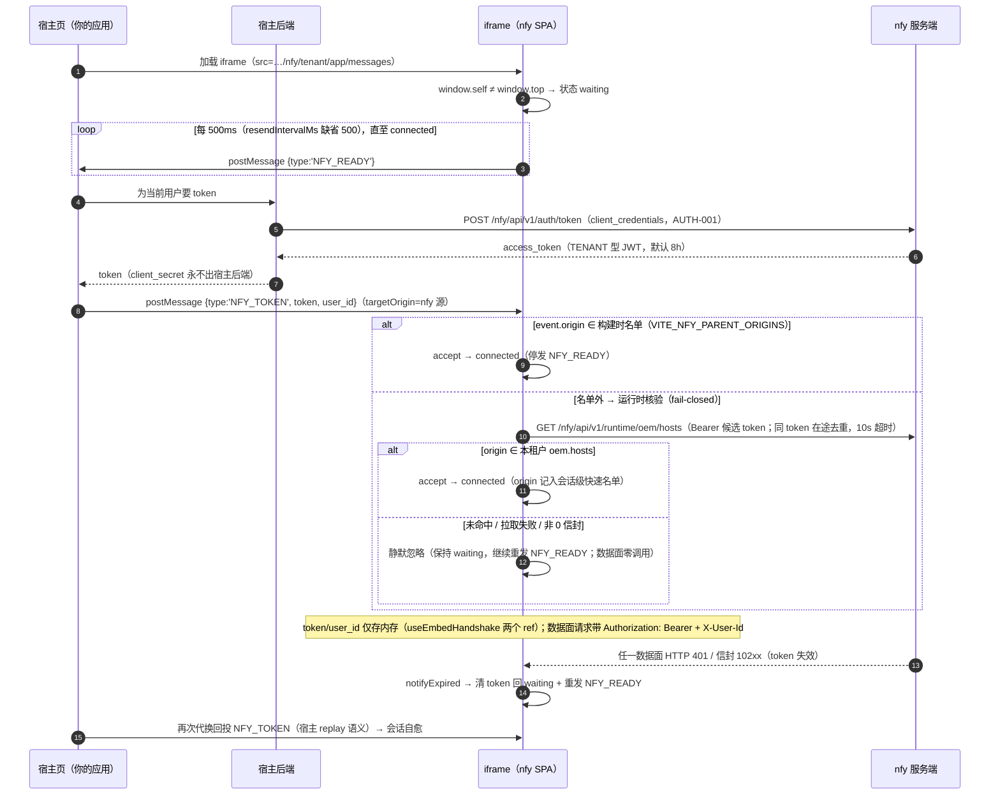

# 前端嵌入详解：握手协议、白名单、铃铛与 OEM

> notification4j 使用手册 · 03-开发指南 · 版本口径 **v1.4.0**。
> 面向读者：已按 [quickstart-frontend](../02-快速开始/quickstart-frontend.md) 嵌出第一个 iframe、
> 现在需要吃透协议细节、安全边界与定制面的前端/全栈工程师。本文由
> 收编扩写自旧 operations/integration-guide.md（原文件已下线）；
> 协议常量与行为逐项核对自源码（`frontend/src/composables/nfy/useEmbedHandshake.ts`、
> `useUnreadCount.ts`、`BellPage.vue`、`NfyShell.vue`、`frontend/src/api/nfy/nfyContext.ts`、
> `frontend/src/router/index.ts`、`backend/.../NfyStaticPageConfig.java`、`OemService.java`），
> 行为口径由 E2E `frontend/e2e-regression/l8-frontend.spec.ts`（L8-01～10）实测钉死。

## 1. 嵌入形态总览

### 1.1 六个入口路由

SPA 托管六个入口（核对自 `frontend/src/router/index.ts` 路由表与
`NfyStaticPageConfig`（`/`、`/nfy/tenant/**` SPA fallback）；五页共用侧栏壳 `NfyShell.vue`，
铃铛为独立单页壳 `BellPage.vue`，均 `meta.public` 自鉴权）：

| # | 路由 | route name | 页面 | 用途 |
|---|---|---|---|---|
| 1 | `/nfy/tenant/app/messages` | `NfyMessages` | 消息列表 | 未读筛选 / 标已读 / 加载更多 / 撤回展示 |
| 2 | `/nfy/tenant/app/announcements` | `NfyAnnouncements` | 公告 | 普通公告标已读、需确认公告「我知道了」 |
| 3 | `/nfy/tenant/app/channels` | `NfyChannels` | 我的渠道 | 渠道注册 / 验证 / 启停 / 删除 |
| 4 | `/nfy/tenant/app/subscriptions` | `NfySubscriptions` | 订阅矩阵 | 消息类型 × 渠道开关（强制类型锁定） |
| 5 | `/nfy/tenant/app/deliveries` | `NfyDeliveries` | 投递记录 | userid/biz_no 筛选、分页，DEAD 行可重投 |
| 6 | `/nfy/tenant/page/bell` | `NfyBell` | 铃铛单页 | 48×48 起 iframe，角标 + 最近 5 条 |

> 路由名逐字取自 router/index.ts；另有 `NfyHome`（`/nfy/tenant/app` 空参重定向到 messages）。
> 五页入口路由形如 `/nfy/tenant/app/:page(messages|announcements|channels|subscriptions|deliveries)?`。
> 深链直开 / 刷新由服务端 fallback 到 SPA 入口 index.html，无需宿主处理（L8-02 钉死 200 + 挂载点）。

### 1.2 两种拓扑对比

| 维度 | 拓扑 A：跨源 iframe（默认） | 拓扑 B：宿主域同源反代（`/nfy/` 前缀） |
|---|---|---|
| iframe src | 绝对地址 `https://nfy.example.com/nfy/tenant/...` | 同源相对路径 `/nfy/tenant/...` |
| `event.origin` | nfy 服务端源 | **宿主域**（白名单须配宿主域） |
| 反代要求 | 无 | `/nfy/` 段**原样透传不 rewrite**（否则资产 404 白屏，697fdf7） |
| 资产路径 | 前端 vite `base='/nfy/'`，产物引用 `/nfy/assets/*`；服务端 `NfyStaticPageConfig` 双轨承接（`/nfy/assets\|images\|oem/**` 映射 + `/nfy/favicon.svg`、`/nfy/logo.svg` 转发，与根前缀 `/assets/**` 并存） | 同左（正因 base 前缀，反代必须带前缀透传） |
| API 基址 | 缺省 `/nfy/api/v1`（相对路径落 nfy 同源） | 同左（经反代落在宿主域，需反代同时放行 `/nfy/api/`） |
| cookie / CSP | 宿主页 CSP 需 `frame-src` 放行 nfy 源 | 天然同源，无 frame-src 需求 |
| 适用 | nfy 独立域名 / 多宿主共用一个实例 | 宿主想把 nfy 收进自家域名与证书（发布口径 697fdf7 实测钉死） |

两种拓扑下握手协议完全一致；唯一差异是白名单里配谁的 origin（§4）。

## 2. postMessage 握手协议全解

### 2.1 时序图



### 2.2 消息字段表（常量与字段名是线契约，勿改）

| 消息 | 方向 | 字段 | 语义与当前状态 |
|---|---|---|---|
| `NFY_READY` | iframe → 父页 | `{type:'NFY_READY'}` | 就绪宣告。500ms 周期重发直至 connected（防父页监听未就绪死锁）；connected 即停（`useEmbedHandshake.ts` `sendReady`/`stopResend`）。 |
| `NFY_TOKEN` | 父页 → iframe | `{type:'NFY_TOKEN', token: string, user_id: string}` | **字段名 `user_id` 为 snake_case**（`useEmbedHandshake.ts` `onMessage`）。仅接受双面白名单内 origin 的投递；token 为空串时停留在 waiting 不置 connected；token/user_id 只进内存 |
| `NFY_URGENT` | iframe → 父页 | `{type:'NFY_URGENT', total: number}` | URGENT 未读**由假转真**（上升沿）时通知，30s 轮询口径（`useUnreadCount.ts` `tick`）。⚠️ 协议已实现、**后端字段待补**：`unread-count` 响应当前只有 `unread_count`/`unconfirmed_count`/`total` 三计数、无 `has_urgent` 字段（`NfyRuntimeMessageController.unreadCount`），故该消息**当前实际不发出** |
| `NFY_NAVIGATE` | iframe → 父页 | `{type:'NFY_NAVIGATE', url: string}` | 铃铛「查看全部」跳转请求，`url` 来自 `BellPage` 的 `jumpUrl` props。⚠️ jar 托管 iframe 形态**永不发出**——bell 路由未透传 `jumpUrl` props，仅组件直用（§7.3）可设 |

父页侧建议：收到任何消息先校验 `e.origin === nfy 源`（防伪造），回投时 `targetOrigin` 显式写 nfy 源，勿用 `'*'`。

### 2.3 状态机、fail-closed 与在途去重

iframe 三态（`EmbedStatus`）：`idle`（非嵌入环境，`window.self === window.top`，独立部署正常使用）→ `waiting`（已嵌入，等 token）→ `connected`（token 已接受）。

- **双面判定**（`onMessage`）：`allowedOrigins.includes(event.origin) || runtimeOrigins.has(event.origin)` 命中直接 accept；否则走 `acceptViaRuntimeList` 持候选 token 拉 `oem.hosts` 核验。
- **fail-closed**：核验未命中、网络失败、非 0 信封、`oem` 损坏、`hosts` 非数组——一律按名单外处理静默忽略（`OemService.hostList` 任何异常回空表；`createFetchExtraOrigins` 任何失败 resolve null 且**不得 reject**）。L8-07/L8-10 实测：核验调用已发出、token 不进内存、数据面零调用。
- **同 token 在途去重**：核验请求以 token 为键进 `inflight` Map，并发重复投递共享同一 Promise，落定即删；10s 超时。
- **会话级快速路径**：核验通过的 origin 记入 `runtimeOrigins` Set，本页面会话内再投递不再核验；**已有会话不抢占**——已 connected 时后到的核验结果直接作废。

### 2.4 会话失效与 replay 重握手

任一数据面请求返回 HTTP 401 或信封 code ∈ 102xx（认证与账号类段，`isAuthExpiredCode`：`401 || 10200≤code<10300`；业务 403 域闸、103xx 权限类**不算**）→ `onAuthExpired` → `handshake.notifyExpired()`：清 token、embedded 态回 waiting 并**重启 NFY_READY 周期重发**，非 embedded 回 idle。

`NfyShell` 占位文案四态（`placeholder` computed）：

| 状态 | 文案 |
|---|---|
| waiting，无 authError | 正在连接… |
| waiting，有 authError | 会话已失效，正在重新连接… |
| 非 waiting，有 authError | 会话已失效，请刷新 |
| 非 waiting，无 authError | 会话已过期，请刷新 |

宿主侧最简自愈写法：**每次收到 NFY_READY 都重新代换并回投**（quickstart §2 即此口径）。E2E 宿主
`nfy-host.html` 用 `sent` 标记 + `?replay=1` 查询参数模拟「只发一次 / 允许重发」两种宿主行为；
不重发的宿主会让 iframe 停在「会话已失效，正在重新连接…」（L8-08 实测，且不再出现误导性「暂无消息」空态）。

## 3. token 代换与生命周期

token 一律由**宿主后端**代换（AUTH-001），`client_secret` 永不出后端——绝不硬编码前端、不进 URL、不进 localStorage/sessionStorage：

```http
POST https://nfy.example.com/nfy/api/v1/auth/token
Content-Type: application/x-www-form-urlencoded

grant_type=client_credentials&client_id={租户OpenID}&client_secret={租户密钥明文}
```

返回 `data.access_token`（TENANT 型 JWT）。生命周期口径（api-spec §2.3）：

- **默认 8h、上限 12h，无 refresh_token**（M2M：密钥即长期凭据，到期重换；续期=到期前 5min 重换）；
- `expires_in` 为**字符串秒数**（`"28800"`，fwk4j-web 数值字符串化策略）；
- `user_id` 不进 JWT claims；iframe 数据面每请求带 `Authorization: Bearer <token>` + `X-User-Id`（`client.ts` 拦截器注入）。V1.0 口径 `X-User-Id` 透传不鉴权；按用户短会话 / claim 绑定校验属推荐级加固，接入方按需启用；
- 嵌入会话内的失效体验（§2.4）：iframe 自动回 waiting 重握手，宿主重投新 token 即自愈，不打断父页。宿主按 `expires_in` 计时到期前主动重换，或干脆每 500ms 的 NFY_READY 都应答（反正握手完成后 iframe 不再发 READY）。

## 4. origin 白名单（双面 ∪，fail-closed）

白名单 = **面 1 构建时注入 ∪ 面 2 运行时 `oem.hosts`**，任一命中即接受；两面都不命中的 `NFY_TOKEN` 一律静默忽略。

### 4.1 面 1 · 构建时注入（改名单需重打 dist）

```bash
# frontend 构建环境变量（读取处：BellPage.vue / NfyShell.vue 的 import.meta.env）
VITE_NFY_PARENT_ORIGINS=https://app.example.com,https://admin.example.com
VITE_NFY_BASE_URL=/nfy/api/v1
```

- 格式：逗号分隔多个 origin（组件初始化时 split/trim）；缺省回落开发默认 `http://localhost:5173,http://localhost:3000`；
- 组件直用时可用 props 覆盖：`<BellPage origins="https://app.example.com" />`（§7.3）；
- **注意**：随仓发布的 dist 按「构建期零 `VITE_*` env」打出（commit 697fdf7 重拷口径）——即出厂产物面 1 实际只有开发缺省对，**生产宿主 origin 一律走面 2 核验**；部署方要把已知宿主烧进面 1 必须自行重打包前端并重拷 `nfy-console/`。

### 4.2 面 2 · 运行时租户 `oem.hosts`（运营时可配、无需重发前端）

```bash
# ① 平台域配置（P 鉴权；新增 host 属安全变更，走租户审批/二次确认——api-spec PTE-002）
curl -X PATCH https://nfy.example.com/nfy/platform/api/v1/tenants/{open_id} \
  -H "Authorization: Bearer <PLATFORM token>" -H "Content-Type: application/json" \
  -d '{"oem":{"hosts":["https://partner.example.com"]}}'
```

② 握手期自动核验：构建时名单外的父页 origin 投递 `NFY_TOKEN` 时，iframe 持该候选 token 调
`GET /nfy/api/v1/runtime/oem/hosts`（API-OEM-001；`@RequiresToken("TENANT", type="access")`，
无 U）拉本租户 hosts，origin 命中才接受（同 token 在途去重；核验失败/未命中 fail-closed）。
响应恒为 `{hosts:[...]}`，`oem` 未配置回 `[]`。平台面 PATCH 生效后**下一个握手周期即可命中**，无需重发前端。

### 4.3 精确匹配规则与常见错误

匹配为 origin **精确串匹配**（scheme+host+port，与浏览器 `event.origin` 序列化一致）：

| 常见错误 | 结果 |
|---|---|
| 协议不一致：页面是 `https://` 名单写 `http://partner.example.com` | 不命中 |
| 端口不一致：本地宿主 `http://localhost:5173` 名单只写 `http://localhost` | 不命中（非默认端口浏览器会序列化进 origin） |
| 带路径：名单写 `https://a.com/app` | 不命中（origin 只有 scheme+host+port，无路径） |
| `https://a.com` vs `https://a.com:443` | 视浏览器序列化而定——默认端口通常不输出 `:443`，名单按 `event.origin` 原样抄最稳 |

排查：同源反代形态（拓扑 B）下 `event.origin` 是**宿主域**——宿主域忘了进面 1 或面 2 是最高频的「正在连接…」原因。

## 5. 铃铛与未读

```html
<!-- 本体 48×48；点击展开「最近消息」下拉面板（宽 300px 绝对定位），为面板预留空间或放大 iframe -->
<iframe src="https://nfy.example.com/nfy/tenant/page/bell"
        style="width:48px;height:48px;border:0"></iframe>
```

行为口径（核对自 `BellPage.vue` + `useUnreadCount.ts`，L8-04/L8-05 钉死）：

- **未读角标 = `GET /runtime/messages/unread-count` 的 `total`**，口径 = 站内信未读 `unread_count` + 公告未确认 `unconfirmed_count`（need_confirm=1 生效公告减已确认回执）；
- **30s 轮询**（`BellPage` 显式 `intervalMs: 30000`，与 composable 缺省一致）：立即首拉 + 周期轮询；页面不可见（`document.hidden`）暂停，恢复可见（visibilitychange）立即补拉；请求失败静默保留旧值不打断轮询；
- 角标 **99+ 封顶**；点击展开最近 **5 条**（`limit=5`，connected 才拉取），未读行加粗；
- 角标联动：消息页「标为已读」→ 接口递减 → 角标同步减（L8-05）；
- 首拉时序注意：铃铛首拉可能**先于握手完成**（空 token 请求静默失败），靠下一轮询或 visibilitychange 补拉追平（L8-04 注释口径）；
- `NFY_URGENT` / `NFY_NAVIGATE` 当前状态见 §2.2 表——父页可先按协议预留监听，不依赖其发出。

## 6. OEM 定制

oem 配置有**三个互不相通的面**，接前先分清（字段级核对自 `frontend/src/config/oem.ts`、`store/oem.ts`、`useEmbedParams.ts`、`PatchTenantRequest.java`）：

**① 平台域租户 `oem`（运行时 jsonb，PATCH 可写、目前仅 hosts 被消费）**
PATCH body 可写 `oem{"theme","title","logo","hosts":[]}`（后端 `PatchTenantRequest.oem` 为自由 `Map<String,Object>` jsonb 参数化写，api-spec PTE-002 口径）。**运行时唯一消费方是 `hosts`**（白名单面 2，`OemService.hostList` → API-OEM-001）；`theme`/`title`/`logo` 当前仅存储、前端不消费。

**② 前端构建期白标（`frontend/src/config/oem.ts` 的 `OEM_CONFIG`，改后须重打包）**

| 字段 | 类型/默认 | 生效点 |
|---|---|---|
| `logoUrl` / `logoDarkUrl` | string / `` `${import.meta.env.BASE_URL}logo.svg` ``（base `/nfy/` 下解析为 `/nfy/logo.svg`，由服务端 `NfyStaticPageConfig` `/nfy/logo.svg` 转发承接——P2-9 修复） | 顶栏 logo |
| `companyName` / `title` / `subtitle` | string / 权益中台 · 权益中台 · 公共权益配置计量中台 | 品牌/标题 |
| `brand` | `ldx2\|mchuan\|apple\|google\|manyun\|acme` 或 string / `acme` | FcThemeProvider 初始品牌 |
| `theme` | `light\|dark` / `light` | 初始主题 |
| `primaryColor`/`successColor`/`warningColor`/`dangerColor` | string | `apply()` 写 `--el-color-*` CSS 变量 |
| `locale` | `zh-CN\|en-US` / `zh-CN` | 语言 |
| `faviconUrl` / `footerText` / `supportUrl` / `loginBgUrl` | string | favicon / 页脚 / 支持链接 / 登录背景 |

`apply()`（`store/oem.ts`）只设置 `document.title`、favicon link、`--el-color-*`；brand/theme 经 App.vue 传 FcThemeProvider 作初始兜底。
注：上表「生效点」为字段设计意图；截至 v1.4.0 逐项核对，有实际消费点的仅 `title`/`faviconUrl`/四色
（`apply()`）与 `brand`/`theme`（App.vue），`logoUrl`/`logoDarkUrl`/`companyName`/`subtitle`/`locale`/
`footerText`/`supportUrl`/`loginBgUrl` 当前无组件读取——`logoUrl` 的现实意义是 P2-9 后正确解析为
`/nfy/logo.svg`（服务端转发承接），配置其余字段暂不会上屏。

**③ URL query 外观参数（嵌入形态唯一免重打包的实时定制面）**
路由守卫解析 `?brand=&mode=&language=`（`useEmbedParams`，即时生效**不写 localStorage**）；白名单校验：brand ∈ `ldx2|apple|google|mchuan|manyun|acme|microsoft|vonnex`、mode ∈ `light|dark`、language ∈ `zh-CN|en-US`，非法值静默忽略。例：`/nfy/tenant/app/messages?brand=apple&mode=dark&language=en-US`。

## 7. 宿主实现参考

### 7.1 联测宿主页（以 E2E `frontend/e2e-regression/hosts/nfy-host.html` 为底，可直接自测）

```html
<!doctype html>
<html lang="zh-CN">
<head><meta charset="utf-8"><title>NFY e2e 宿主</title>
<style>body{font:14px/1.6 system-ui;margin:0}iframe{display:block;width:100%;
height:calc(100vh - 41px);border:0}</style></head>
<body>
<header>宿主应用（模拟业务方页面）<span id="st">握手未开始</span></header>
<iframe id="nfy" src="about:blank"></iframe>
<script>
// 宿主页（origin http://localhost:3000 —— 出厂构建时白名单内）：
// 参数：?page=messages|announcements|channels|subscriptions|deliveries
//       &token=..&user_id=..&replay=1（replay=1：token 失效后允许重投，模拟自愈宿主）
const q = new URLSearchParams(location.search)
const page = q.get('page') || 'messages'
const st = document.getElementById('st')
const frame = document.getElementById('nfy')
frame.src = 'http://localhost:9200/nfy/tenant/app/' + page   // 换成你的 nfy 地址

const token = q.get('token') || ''        // 联测时手工传；生产改为调宿主后端代换
const userId = q.get('user_id') || ''
let sent = false

window.addEventListener('message', (e) => {
  if (e.origin !== 'http://localhost:9200') return   // 只信任 nfy 源，防伪造
  if (e.data && e.data.type === 'NFY_READY') {
    st.textContent = '收到 NFY_READY' + (sent ? '（重握手）' : '')
    if (!sent || q.get('replay') === '1') {
      e.source.postMessage({ type: 'NFY_TOKEN', token, user_id: userId }, 'http://localhost:9200')
      sent = true
    }
  }
})
// 供 e2e 断言握手状态（宿主侧观察点，不影响产品）
window.NFY_HOST_STATE = () => ({ sent, page, tokenLen: token.length, userId })
</script>
</body>
</html>
```

备用宿主 `nfy-host-alt.html`（origin `http://localhost:13001`，构建时名单外）用于验证面 2：
oem.hosts 含 13001 → 握手成功（L8-09）；不含 → 拒绝（L8-10）。两页参数完全一致。

### 7.2 Vue 3 宿主组件示例（每次 READY 都应答，天然自愈）

```vue
<script setup lang="ts">
import { onMounted, onBeforeUnmount } from 'vue'
const props = defineProps<{ nfyOrigin: string; path?: string }>()
// nfyOrigin 如 'https://nfy.example.com'；path 如 '/nfy/tenant/app/messages' 或 '/nfy/tenant/page/bell'

async function onMessage(e: MessageEvent) {
  if (e.origin !== props.nfyOrigin) return
  if ((e.data as { type?: string })?.type !== 'NFY_READY') return
  // token 由宿主后端代换（AUTH-001），前端只见 token 不见 secret
  const d = await fetch('/api/nfy-token', { credentials: 'same-origin' }).then((r) => r.json())
  e.source?.postMessage({ type: 'NFY_TOKEN', token: d.token, user_id: d.user_id }, props.nfyOrigin)
}
onMounted(() => window.addEventListener('message', onMessage))
onBeforeUnmount(() => window.removeEventListener('message', onMessage))
</script>

<template>
  <iframe :src="nfyOrigin + (path ?? '/nfy/tenant/app/messages')"
          style="width:100%;height:calc(100vh - 56px);border:0" />
</template>
```

### 7.3 组件直用形态（props 覆盖）

把 `frontend` 源码组件直接引入宿主工程（而非 iframe 托管）时可用 props：
`NfyShell`：`{ baseUrl?, origins? }`；`BellPage`：`{ baseUrl?, origins?, jumpUrl? }`——此形态下
`jumpUrl` 可设，是 `NFY_NAVIGATE` 唯一能发出的路径（§2.2）。iframe 托管形态路由不透传 props。

## 8. 安全清单（嵌入面）

- **token 不落地**：仅经 postMessage 进 iframe 内存（两个 ref），不写 URL / sessionStorage / localStorage（L8-01 宿主侧断言 tokenLen 一致）；`client_secret` 只存宿主后端；
- **白名单 fail-closed**：双面 ∪ 判定，名单外/核验失败一律忽略（L8-07/L8-10）；新增 `oem.hosts` 属安全变更走平台审批；
- **宿主双向校验**：收消息先验 `e.origin === nfy 源`；回投 `targetOrigin` 显式写 nfy 源，勿 `'*'`；
- **iframe sandbox 建议**：跨源拓扑（A）可加 `sandbox="allow-scripts allow-same-origin"`——iframe 内容是 nfy 源而非宿主源，该组合允许其正常发自身 API 请求，又触达不到宿主同源存储；当前六个页面源码无 `window.open` / `target="_blank"` 外链（检索核实，公告 `link_url` 仅存在于 API 类型未渲染为链接），无需 `allow-popups`。同源反代拓扑（B）下 sandbox 无净收益：去掉 `allow-same-origin` 会令 iframe origin 序列化为 `null`（白名单永不命中，与 L8-07 的 about:blank 同理）、API 请求亦跨源；保留则与不加等权——安全依赖握手白名单；
- **CSP 注意**：宿主页 CSP 需 `frame-src`/`child-src` 放行 nfy 源（拓扑 A）；服务端当前**未下发** `Content-Security-Policy: frame-ancestors` 响应头（代码检索无实现，api-spec PTE-002 的 frame-ancestors 表述为规划口径）——嵌入可见性不受服务端 CSP 限制，token 安全靠白名单握手而非「隐藏 iframe」；
- iframe 内所有 API 请求经 TENANT token，租户侧可观测可审计；
- 签名按租户开关（`privileges.signature`），**出厂默认不强制**（嵌入面前端无 secret 可签）；S2S 对接需防重放时自行加回 runtime pattern，详见 [signature.md](signature.md)；
- 渠道面 SSRF 防护（用户自注册 webhook 仅官方域名白名单 + 443 + DNS 禁内网段）与嵌入无直接关系，随渠道功能默认生效。

## 9. 常见问题（FAQ）

| 症状 | 原因与排查 |
|---|---|
| 一直「正在连接…」，无侧栏 | origin 不在双面白名单（最高频）。按序查：① 协议/端口/路径写错（§4.3）；② 同源反代下忘了把**宿主域**配进名单；③ `oem.hosts` 未配或拼错。Network 面板应能看到 `/runtime/oem/hosts` 核验调用及其返回；L8-07/L8-10 口径：核验未命中 → 数据面零调用 |
| 「会话已失效，正在重新连接…」不恢复 | 宿主只投了一次 token（无 replay）。宿主应在每次收到 `NFY_READY` 时重新代换回投（§7.2 即自愈写法）；L8-08 实测不重发会停在重连占位 |
| token 无效/过期如何分辨 | 无效签名 token 数据面回 HTTP 200 + 信封 `code=10202`；过期回 10201 段——均触发 `notifyExpired` 重握手。排查=宿主后端拿同 token 直接 curl 数据面接口复核；token 默认 8h（`expires_in` 字符串秒数），到期前 5min 重换；多实例部署注意节点时钟同步（JWT exp 由服务端时钟判定） |
| 铃铛角标不动 / 滞后一轮 | 30s 轮询口径 + 页面不可见暂停；首拉可能先于握手（空 token 静默失败），恢复可见立即补拉（L8-04）；等一轮或触发 visibilitychange 即追平 |
| 反代形态 iframe 白屏 / 资产 404 | 反代把 `/nfy/` 前缀 rewrite 掉了。前端 vite `base='/nfy/'`，产物引用 `/nfy/assets/*`，反代必须**原样透传不 rewrite**，服务端由 `/nfy/assets\|images\|oem/**` 双轨映射承接（697fdf7） |
| 需要配跨域 cookie 吗 | 不需要。协议不依赖 cookie：token 走 postMessage + `Authorization` 头，宿主与 nfy 之间无 SameSite/withCredentials 问题 |
| 想改 nfy 的 logo/标题/配色 | 平台域 `oem.theme/title/logo` 当前不被前端消费（§6）；免重打包的实时面只有 URL query `?brand=&mode=&language=`；深度白标改 `frontend/src/config/oem.ts` 后重打包（§4.1 同流程） |

---

> 取证源清单：`frontend/src/composables/nfy/useEmbedHandshake.ts`（NFY_READY 500ms/NFY_TOKEN 字段/双面判定/在途去重/notifyExpired）、`frontend/src/composables/nfy/useUnreadCount.ts`（30s 轮询/NFY_URGENT）、`frontend/src/views/nfy/BellPage.vue`（props/角标/NFY_NAVIGATE）、`frontend/src/views/nfy/NfyShell.vue`（占位文案）、`frontend/src/api/nfy/nfyContext.ts`（createFetchExtraOrigins 10s 超时契约）、`frontend/src/api/nfy/client.ts`（Authorization/X-User-Id/102xx）、`frontend/src/router/index.ts`（六路由）、`frontend/vite.config.ts`（base '/nfy/'）、`backend/.../autoconfigure/NfyStaticPageConfig.java`（双轨映射/SPA fallback）、`backend/.../controller/NfyRuntimeOemController.java` 与 `service/OemService.java`（API-OEM-001 fail-closed）、`backend/.../controller/NfyRuntimeMessageController.java`（unread-count 三计数）、`backend/.../dto/PatchTenantRequest.java`（oem Map jsonb）、`frontend/e2e-regression/hosts/nfy-host.html`/`nfy-host-alt.html` 与 `frontend/e2e-regression/l8-frontend.spec.ts`（L8-01～10）、commit 697fdf7、[docs/api/api-spec.md](../../api/api-spec.md)（AUTH-001/PTE-002/API-OEM-001）。
