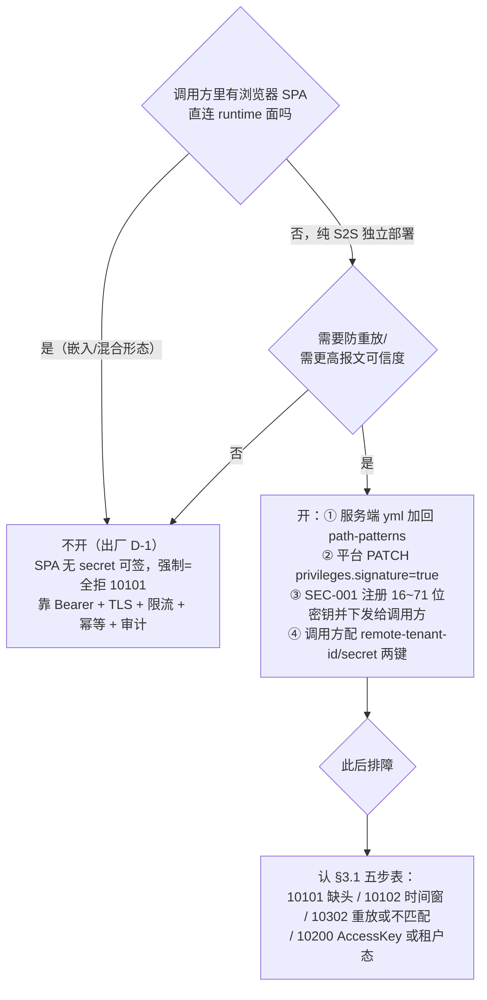

# 开发指南 · 接口签名（HMAC-SHA256 防重放，S2S 可选）

> notification4j 使用手册 · 03-开发指南第 3 篇 · 版本口径 **v1.4.0**（Maven `1.4.0` / tag `v1.4.0`）。
> 面向读者：跨进程（S2S）调 OpenAPI、且部署侧决定开启请求签名的业务方后端工程师。
> 签名串构造、时间窗、nonce、错误码逐字核实自 framework4j v1.7.1 源码
> （`signature/SignatureService` / `SignatureUtil` / `BodyMd5Util` / `SignatureInterceptor` /
> `SignatureProperties` / `SignatureAutoConfiguration`）；活体行为核实自 `NfySignatureFaceTest` /
> `NfySignatureKeyTest`（IT）；客户端侧核实自 client-starter `NfyHmacSigner` /
> `AuthenticatedHttpTransport` / `ClientAutoConfiguration`（+ `NfyClientStarterTest` 逐字节等价回归）；
> 出厂默认与示例抄自 app `application.yml` signature 段注释（D-1，V1.2.2）。

## 1. 出厂默认：不强制，何时需要自己加回

**出厂（V1.2.2/D-1）不对任何路径强制签名**——app `application.yml`：

```yaml
framework4j:
  signature:
    enabled: true                      # 模块与密钥解析基础设施保留
    timestamp-tolerance-ms: 300000     # ±5min
    nonce-ttl-seconds: 600             # nonce 10min 一次性
    nonce-key-prefix: notification4j:sig:nonce
    redis-name: default
    # D-1 修复：出厂不对 runtime 强制签名 —— SPA 与 S2S 共用 runtime 路径，嵌入面无 secret 可签，
    # 强制签名会令消息中心 SPA 全拒 10101。S2S 对接需要时自行加回 pattern（密钥解析由本项目
    # NfyTenantSecretProvider 提供，starter 已 @AutoConfigureBefore 排序修 D-2）：
    # path-patterns: ["/nfy/api/v1/runtime/**", "/nfy/api/v1/assets-runtime/**"]
    path-patterns: []                  # 空 = 拦截器不注册任何路径
    exclude-path-patterns: []
```

原因：runtime 路径 `/nfy/api/v1/runtime/**` 被**嵌入形态的浏览器 SPA 与 S2S 共用**，浏览器端
拿不到租户 secret、不可能算 HMAC——出厂强制等于消息中心全拒 10101。因此出厂只保留
`enabled: true` 与密钥解析链（`NfyTenantSecretProvider`），**防重放成为部署级决策**：纯 S2S 的
独立部署在服务端把上面的 `path-patterns` 注释行解开即开签名面。安全兜底不缺席：未开签名时由
Bearer token（[auth.md](auth.md)）+ TLS + 限流 + 幂等键 + 审计承担（ADR-0008 风险声明）。

## 2. 签名开关按租户：privileges.signature（ADR-0008）

- **登记入口**：平台建租户 `POST /nfy/platform/api/v1/tenants` body 可带 `privileges{}`；租户配置
  修改 `PATCH /nfy/platform/api/v1/tenants/{tenant_open_id}` 可改 `privileges{signature,delivery}`
  （PTE-001/PTE-002，`PlatformTenantService.patchJsonColumn` 写 `nfya_tenant.privileges` jsonb）。
- **语义（ADR-0008 冻结）**：`privileges.signature=true` 开启后——**密钥未注册=全拒（安全默认）、
  已注册=强制校验**；未开启=不校验（默认关）。
- **实现分层（v1.4.0 实况）**：租户开关登记在 `nfya_tenant.privileges`；**拦截是否发生由部署侧
  `framework4j.signature.path-patterns` 决定**（fwk4j `SignatureAutoConfiguration`：patterns 为空
  即不注册拦截器）。三层配齐签名面才真正生效：① 部署侧 yml 加回 pattern；② 平台侧
  `privileges.signature=true` 登记；③ 租户侧 SEC-001 注册密钥（§4）。

## 3. 四元组协议（以 fwk4j v1.7.1 源码签名为准，逐字）

开启后，命中 path-patterns 的每个请求必须带 4 个头（`SignatureProperties.HeaderNames` 出厂名）：

| Header | 取值 | 核实 |
|---|---|---|
| `X-Access-Key` | **租户 OpenID**（PTE-001 下发的 12 字符 open_id；服务端 `NfyTenantSecretProvider` 用 `IdObfuscator.fromOpenId` 反解雪花 id 查租户取密钥） | `NfyTenantSecretProvider.getSecret` |
| `X-Timestamp` | Unix **毫秒**时间戳字符串 | `SignatureService.validate` |
| `X-Nonce` | 一次性随机串（客户端用 UUID v4） | `NfySignatureFaceTest.signGet` |
| `X-Signature` | 签名值（下式） | 同上 |

**签名串构造（`SignatureUtil.buildStringToSign`，与 client-starter `NfyHmacSigner` 逐字节一致，
`NfyClientStarterTest` 防漂移回归）**：

```
签名串 = METHOD + "\n" + PATH + "\n" + TIMESTAMP + "\n" + NONCE + "\n" + BODY_MD5
签名值 = BASE64( HMAC_SHA256( tenant_secret, 签名串 ) )
```

五要素口径（服务端 `SignatureService` 逐字实现）：

1. `METHOD`：HTTP 方法大写（GET/POST/PUT/…）；
2. `PATH`：请求路径，**不含 query string**（query 参数不参与签名；服务端取 `request.getRequestURI()`）；
3. `TIMESTAMP`/`NONCE`：与两个头同值原文；
4. `BODY_MD5`：**请求体字节的 MD5 小写 hex（32 字符）**；无 body（GET）= 空字节数组的 MD5
   （`d41d8cd98f00b204e9800998ecf8427e`）。自定义实现务必对**实际发送的字节**算 MD5——先序列化
   定稿再签名，避免「重签时二次序列化产出不同 JSON」；
5. 服务端比较用 `MessageDigest.isEqual` **常量时间比较**（防 timing attack，禁 String.equals）。

**时间窗与 nonce**：`|now − X-Timestamp| ≤ 300000ms（±5min，timestamp-tolerance-ms）`；nonce 经
Redis Lua `SET NX EX 600` 原子判重，**10 分钟内（nonce-ttl-seconds）仅可出现一次**——同 nonce
再次到达即判重放。

### 3.1 服务端五步校验与错误码（v1.7.1 实况，IT 双钉）

失败一律 **HTTP 401 + 信封**（`SignatureInterceptor` 直接写响应，不走全局异常处理器）：

| 步 | 校验 | 失败信封 code（message 实测原文） | IT |
|---|---|---|---|
| 1 | 4 头齐全 | `10101`「签名头缺失」 | `NfySignatureFaceTest` 未带签名头 → 10101 |
| 2 | timestamp 可解析且在 ±5min 窗内 | `10102`「timestamp 格式错误」/「签名时间戳过期或超前（容忍 ±300s）」 | 源码 |
| 3 | nonce 一次性 | `10302`「nonce 已被使用（重放攻击）」；Redis 故障 → `10005`「签名校验中间件异常」 | 源码 |
| 4 | AccessKey 反解出 ACTIVE 租户且有密钥 | `10200`「未知的 AccessKey」（含租户 SUSPENDED，签名面同断） | 修 D-2 前的 10200 活体复现 |
| 5 | HMAC 常量时间比对 | `10302`「签名值不匹配」 | 源码 |

> 与 api-spec §2.4 的差异声明：api-spec 写作「`10302` + error 子类型
> SIGNATURE_MISSING/EXPIRED/REPLAYED/INVALID」；v1.7.1 实现**没有独立子类型字段**，四态靠上表
> 不同 code（10101/10102/10302/10200）区分，排查请认 code+message。
> D-2 提醒：正确签名也可能全拒 10200——旧版 fwk4j 的 InMemorySecretProvider 兜底抢先注册所致，
> v1.4.0 已由 `NfyAutoConfiguration @AutoConfigureBefore(SignatureAutoConfiguration)` 修复并有
> `NfySignatureFaceTest` 防回归；自托管旧版本升级见 [upgrade-guide](../07-版本与支撑/upgrade-guide.md)。

## 4. 密钥管理（API-SEC-001，《租户设计》§5.5）

**`tenant_secret` 一钥双用途**：client_credentials 认证凭据 + HMAC-SHA256 签名密钥。存储在
`nfya_tenant.tenant_secret` **AES-GCM 加密列**（读写经 typeHandler 自动加解密，接口永不回显明文；
`NfyTenantSecretProvider` 读解密列供验签）。

端点（TENANT token，admin 面）：

| 端点 | 行为 | 响应要点 |
|---|---|---|
| `GET /nfy/api/v1/admin/signature-key` | 查询密钥状态（脱敏） | `{configured, masked, has_prev, prev_at}`；`masked` = 前 2 + `****` + 后 2（≤8 位全掩码） |
| `POST /nfy/api/v1/admin/signature-key` body `{"secret":"..."}` | 注册/轮换 | 长度 **16~71** 否则信封 10100；成功 `{rotated:true, masked}` |

轮换语义（`SignatureKeyService` + `TenantAuthTemplate`，均已核实）：

- **新密钥立即生效**：换 token 跨过轮换立刻可用（`NfySignatureKeyTest` 实测，含 `rotated:true` /
  `has_prev:true` 断言）；签名与 token 同读 `tenant_secret` 列，同刻随之切换；
- **认证侧旧密钥有 24h 宽限**：旧值入 `tenant_secret_prev`/`prev_at`，宽限期内旧密钥仍可换 token
  （`framework4j.tenant.secret.grace-hours: 24`，懒校验无清理任务）；平台 PTE-003 重置密钥同口径；
- **签名侧旧密钥立即失效**：`NfyTenantSecretProvider` 只返回当前密钥——**S2S 调用方必须在轮换后
  立刻切换新密钥**，否则 10200。稳妥顺序：先发新密钥给调用方 → 调用方切换 → 再在平台登记轮换。

## 5. Java 客户端：配齐两键即自动签名

client-starter（或全量 starter `mode: remote`）的 `AuthenticatedHttpTransport` 对每个
post/get/put/delete **自动注入签名四头 + Bearer**，条件仅一个：`nfy.runtime.remote-tenant-id`
与 `remote-tenant-secret` 两键配齐（`X-Access-Key` 即 remote-tenant-id / 租户 OpenID）；缺任一键
则签名四头与 Bearer **一并不注入**、仅打 WARN（`AuthenticatedHttpTransport.enrich` 在两键检查后
才走 Bearer 分支）。

```yaml
nfy:
  runtime:
    client-enabled: true
    mode: remote
    remote-url: http://notification4j-svc:9200
    remote-tenant-id: t_xxxx            # 租户 OpenID = X-Access-Key
    remote-tenant-secret: xxxx          # HMAC 密钥（SEC-001 注册/PTE-001 下发）
```

> Bearer 注意：默认装配（classpath 有 framework4j-accesstoken 时）注入的是 **SERVICE 型** S2S JWT，
> 会被服务端 TENANT 校验拒 10300——请按 [quickstart-remote.md §6](../02-快速开始/quickstart-remote.md)
> 接 AUTH-001 的 TENANT token 作供源；自定义 `HttpTransport` Bean 会让位装配，HMAC 四头仍自动注入。

不用 starter 时手写（与 `NfyHmacSigner` 同构，按真实签名串）：

```java
long ts = System.currentTimeMillis();
String nonce = UUID.randomUUID().toString();
byte[] bodyBytes = json.getBytes(StandardCharsets.UTF_8);   // 先定稿实际发送的字节
String bodyMd5 = md5Hex(bodyBytes);                          // 小写 hex 32 位；GET 用空字节数组
String sts = method + "\n" + path + "\n" + ts + "\n" + nonce + "\n" + bodyMd5;   // path 不含 query
Mac mac = Mac.getInstance("HmacSHA256");
mac.init(new SecretKeySpec(secret.getBytes(StandardCharsets.UTF_8), "HmacSHA256"));
String signature = Base64.getEncoder().encodeToString(mac.doFinal(sts.getBytes(StandardCharsets.UTF_8)));
// 头：X-Access-Key=openId, X-Timestamp=String.valueOf(ts), X-Nonce=nonce, X-Signature=signature
```

## 6. 决策树：什么时候开签名



| 场景 | 建议 |
|---|---|
| 嵌入形态（SPA + starter 同进程） | 不开（无意义且必拒 SPA） |
| client-starter 跨进程，一般业务 | 可不开：Bearer 已鉴权、TLS 已加密通道；签名增量收益=防重放/防报文篡改 |
| 开放网络/高安全诉求 S2S | 开：三层配齐（§2）+ 密钥轮换流程（§4） |
| 已开但接入方非 Java | 按 §3 协议手写（五要素口径逐字对齐，注意 body MD5 取实际发送字节） |

## 7. 相关路径

- [auth.md](auth.md)（Bearer 与签名叠加时的 token 口径）、[onboarding.md](onboarding.md)（拿 open_id/secret）、
  [sending.md](sending.md)（S 可选端点清单）、[error-codes.md](../04-参考/error-codes.md)
- api-spec [§2.4 通用 Header](../../api/api-spec.md)（S可选 口径）、ADR-0008（按租户开关决策）、
  设计文档 `docs/design/adr/adr-0008-per-tenant-signature.md`
